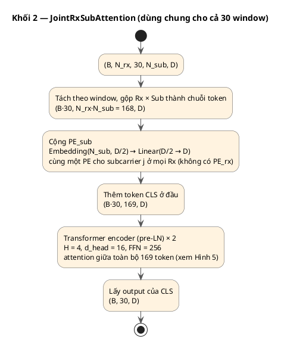
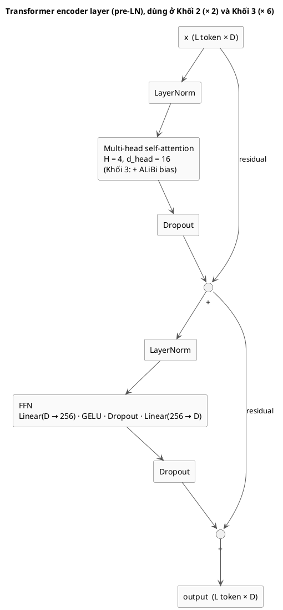

# CSI-WiFormer: Kiến trúc nhận dạng hành động người với WiFi CSI
**Phiên bản**: v5 · N_rx: 3–6 · N_sub: 30 hoặc 56 · **Cập nhật**: tháng 11/2026

> Tài liệu này mô tả kiến trúc ở mức thiết kế. Chi tiết cài đặt (shape từng bước, ablation, cách chia dữ liệu)
> xem [WiFormer_Architecture_Implemented.md](WiFormer_Architecture_Implemented.md). Code: [models/wiformer.py](models/wiformer.py).

---

## 1. Tổng quan

CSI-WiFormer là kiến trúc học máy cho bài toán Human Activity Recognition (HAR) sử dụng tín hiệu WiFi CSI (Channel State Information).

### 1.1 Ý tưởng chính

Một hành động được nhận dạng qua **chuỗi các "bức tranh không gian" biến đổi theo thời gian**. Mô hình trả lời lần lượt ba câu hỏi:

| Bước | Câu hỏi | Cách làm |
|---|---|---|
| Cắt đoạn | Tín hiệu trong từng khoảng thời gian ngắn trông như thế nào? | Chia tín hiệu thành các đoạn ngắn chồng lấn, trích đặc trưng mỗi đoạn |
| Không gian | Trong một đoạn, những Rx và subcarrier nào đang phản ánh chuyển động? | Attention giữa các (Rx, subcarrier) → một "bức tranh không gian" cho mỗi đoạn |
| Thời gian | Các bức tranh không gian thay đổi ra sao qua các đoạn? | Attention giữa các đoạn → một vector đại diện cho cả hành động → phân loại |

```
tín hiệu CSI ──► các đoạn chồng lấn ──► bức tranh không gian s_i của từng đoạn ──► chuỗi s_0 … s_n ──► hành động
                  (Khối 1)               (Khối 2)                                   (Khối 3)
```

### 1.2 Ba insight thiết kế

Kiến trúc được thiết kế dựa trên 3 insight:

1. **Hành động là chuỗi các đoạn ngắn nối tiếp → chia tín hiệu thành window chồng lấn (Khối 1)**: chuỗi CSI 5 s (T = 1000 mẫu) được cắt bằng sliding window W = 64 mẫu (0.32 s), bước S = 32 mẫu (0.16 s), thành **30 window chồng nhau 50%** (w0: 0–0.32 s, w1: 0.16–0.48 s, …, w29: 4.68–5.0 s). Hai window liền kề chia sẻ 32 mẫu, nên một micro-pattern nằm ở ranh giới window vẫn được biểu diễn nguyên vẹn trong ít nhất một window, và các window liền kề có tính liên tục. Khối 1 trích đặc trưng của từng đoạn (Rx, sub, window) bằng hai nhánh song song: Conv1d (hình dạng tín hiệu theo thời gian) và FFT (thành phần tần số).
2. **Tại mỗi thời điểm, chỉ một số (Rx, subcarrier) nhạy với chuyển động → joint attention không gian trong từng window (Khối 2)**: tùy vị trí người, hướng di chuyển và multipath, ở mỗi window chỉ một số subcarrier của một số Rx "bắt được" chuyển động (vd. lúc 0.5 s là Rx2/sub40, lúc 1.0 s là Rx1/sub12). Khối 2 cho N_rx × N_sub token của cùng một window attend lẫn nhau rồi tóm tắt thành **1 vector s_i — "bức tranh không gian" của window i**. Không dùng PE_rx (chỉ có PE_sub), nên mô hình phân biệt Rx qua nội dung tín hiệu chứ không qua chỉ số Rx.
3. **Hành động hình thành từ cách các bức tranh không gian biến đổi theo thời gian → Transformer trên chuỗi s_0 … s_29 (Khối 3)**: một window đơn lẻ không đủ để nhận dạng hành động; cần biết s_i thay đổi thế nào qua các window (vd. "s_3 trước, s_6 theo cách này" → đứng lên). Trong Khối 3, mọi cặp (s_i, s_j) attend trực tiếp với nhau, token CLS tổng hợp toàn bộ chuỗi để đưa vào classifier. ALiBi cộng bias `−m · |i − j|` vào attention score: window gần nhau ít bị giảm trọng số hơn window xa, và mô hình không bị gắn với vị trí tuyệt đối của hành động trong mẫu 5 s.

### 1.3 Ba khối của mô hình

Mô hình gồm 3 khối nối tiếp:

| Khối | Vai trò | Thành phần chính |
|---|---|---|
| Khối 1 | Đặc trưng cục bộ của từng (Rx, window, sub) | Sliding window 50% overlap → nhánh Conv1d (3 lớp, flat4) ‖ nhánh FFT → fuse |
| Khối 2 | Kết hợp không gian (Rx × Sub) trong từng window | Joint self-attention trên N_rx·N_sub token + PE_sub + CLS |
| Khối 3 | Mô hình hoá thời gian giữa các window | Transformer 6 lớp với ALiBi + CLS |

---

## 2. Cấu hình hệ thống

| Thông số | Giá trị |
|---|---|
| Cấu hình anten | 1 Tx · N_rx Rx |
| Số anten sử dụng | **1 anten/Rx** — nếu Rx có nhiều anten, chỉ dùng anten[0] |
| N_rx | 3 đến 6 (linh hoạt theo dataset) |
| Sampling rate | 200 Hz |
| Độ dài mẫu | 5 giây → T = 1000 mẫu |
| N_sub | **30 hoặc 56** tùy dataset (xem mục 2.1) |
| Số lớp | SSHAR-ESP: **8** = 7 hành động + phòng trống |
| Các lớp (SSHAR-ESP) | Ngồi xuống, Đứng lên, Cúi, Ngã, Nằm im, Đi, Chạy, Phòng trống |

### 2.1 Lựa chọn anten và subcarrier theo dataset

```
Nếu Rx có nhiều anten:
  x = x[:, :, 0, :, :]   # chỉ lấy anten[0] của mỗi Rx
  → shape: (B, N_rx, N_sub, T)

N_sub theo chuẩn 802.11:
  802.11n 20 MHz → 56 subcarrier  (ví dụ: SSHAR-ESP tự thu, NTU-Fi HAR)
  802.11n 20 MHz → 30 subcarrier  (ví dụ: Widar3.0, UT-HAR, XRF55)
```

Toàn bộ kiến trúc không phụ thuộc giá trị cụ thể của N_sub. Chỉ `Embedding(N_sub, D//2)` trong Khối 2 cần điều chỉnh.

### 2.2 Ảnh hưởng khi thay đổi N_rx và N_sub

| Khối | Thay đổi khi N_rx tăng | Thay đổi khi N_sub thay đổi |
|---|---|---|
| Khối 1 | FLOPs tăng tuyến tính · Params không đổi | FLOPs tăng tuyến tính · Params không đổi |
| Khối 2 | Seq tăng → FLOPs tăng O(N_rx²·N_sub²) · Params không đổi | Seq thay đổi → FLOPs thay đổi · PE_sub thay đổi 32 params/sub |
| Khối 3 | **Không đổi** | **Không đổi** |
| Classifier | **Không đổi** | **Không đổi** |

---

## 3. Siêu tham số

### 3.1 Siêu tham số kiến trúc

| Ký hiệu | Giá trị | Mô tả |
|---|---|---|
| D | 64 | Chiều embedding toàn mô hình |
| F | 64 | Số kênh output của Conv1d stack (= D) |

**Khối 1 — Sliding window + Conv1d ‖ FFT**:

| Ký hiệu | Giá trị | Mô tả |
|---|---|---|
| W | 64 mẫu = 0.32s | Window size — bắt được 1 chu kỳ chạy (0.25s), không loãng ngã (0.3–0.5s), lũy thừa 2 |
| S | 32 mẫu = 0.16s | Stride — overlap 50%, continuity giữa window liền kề |
| n_win | 30 | ⌊(T−W)/S⌋+1 = ⌊(1000−64)/32⌋+1 = 30 |
| Conv 1 | Conv1d(1→32, k=8, s=2) | 64 → 32 bước |
| Conv 2 | Conv1d(32→64, k=4, s=2) | 32 → 16 bước |
| Conv 3 | Conv1d(64→64, k=3, s=1) | giữ 16 bước, tăng độ sâu |
| Pool | AdaptiveAvgPool1d(4) → flatten | **flat4**: giữ 4 bước × 64 kênh = 256, mỗi bước ~80 ms |
| proj_time | Linear(256 → D) | v_time |
| FFT | rfft(W) → log1p(\|X\|) → bỏ DC | 32 bin tần số (0 → 100 Hz, bước 3.125 Hz) |
| proj_freq | Linear(32 → D) | v_freq |
| fuse | Linear(2D → D) | gộp [v_time ‖ v_freq] |

Mỗi Conv1d theo sau bởi BatchNorm + GELU. Trọng số Khối 1 dùng chung cho mọi (Rx, window, sub).

**Khối 2 — Joint (Rx × Sub) attention**:

| Ký hiệu | Giá trị | Mô tả |
|---|---|---|
| L₂ | 2 | Số TransformerEncoderLayer (pre-LN) |
| h₂ | 4 | Số attention head |
| d_head₂ | 16 | Chiều per head (D/h₂ = 64/4) |
| FFN₂ | 256 | Chiều feedforward (4·D) |
| dropout₂ | 0.1 | Dropout trong attention và FFN |
| PE_rx | Không dùng | Không có positional encoding theo index Rx — mô hình học từ tín hiệu |
| PE_sub | Embedding(N_sub, D//2) → Linear(D//2, D) | Encode thứ tự tần số của subcarrier |
| seq₂ | N_rx · N_sub + 1 | Sequence length (gồm CLS token) |

Ví dụ seq₂: N_rx=3, N_sub=56 → 169 token; N_rx=3, N_sub=30 → 91 token; N_rx=6, N_sub=56 → 337 token.

**Khối 3 — Temporal Transformer**:

| Ký hiệu | Giá trị | Mô tả |
|---|---|---|
| L₃ | **6** | Số TransformerEncoderLayer (pre-LN) |
| h₃ | 4 | Số attention head |
| d_head₃ | 16 | Chiều per head (D/h₃ = 64/4) |
| FFN₃ | 256 | Chiều feedforward (4·D) |
| dropout₃ | 0.1 | Dropout trong attention và FFN |
| PE_win | ALiBi | Relative positional bias — không inject vị trí tuyệt đối |
| seq₃ | n_win + 1 = 31 | Sequence length (n_win=30 window token + 1 CLS token) |

ALiBi slope: `m_h = 2^(−8h/n_heads)` với h = 1..n_heads. Không có tham số học.

**Classifier**:

| Ký hiệu | Giá trị | Mô tả |
|---|---|---|
| dropout_clf | 0.1 | Dropout trước Linear |
| n_class | 8 (SSHAR-ESP) | Số lớp |

### 3.2 Siêu tham số huấn luyện

| Ký hiệu | Giá trị | Mô tả |
|---|---|---|
| Optimizer | Adam | weight decay = 0 |
| lr | 1e-3 | Learning rate khởi đầu |
| warmup | 5 epoch | Linear warmup |
| lr scheduler | CosineAnnealingLR | T_max = epochs − warmup |
| batch size | 32 | Có thể dùng gradient accumulation (vd. 8 × 4) nếu thiếu VRAM |
| epochs | tối đa 100 | Early stopping theo val accuracy (patience 10) |
| Chọn mô hình | Checkpoint có val accuracy cao nhất | Báo cáo trên test bằng checkpoint đó |
| weight init | Xavier uniform | Cho Linear và Q/K/V; Conv dùng Kaiming; CLS/Embedding dùng trunc normal 0.02 |

---

## 4. Luồng tensor

```
Input raw      (B, N_rx, N_ant, N_sub, T)    nếu dataset có nhiều anten
  │
  ├─ Chọn anten  x = x[:, :, 0]
  │              (B, N_rx, N_sub, T=1000)    N_sub ∈ {30, 56}
  │
  ├─ Norm        z-score per (rx, sub) per sample, dọc trục T
  │              (B, N_rx, N_sub, T)
  │
  ├─ Khối 1     unfold(W=64, S=32) → [Conv1d×3 + flat4 ‖ FFT] → fuse   (shared weights)
  │              (B, N_rx, n_win=30, N_sub, D=64)
  │
  ├─ Khối 2     flatten (N_rx·N_sub token) + PE_sub + CLS + self-attn (L=2)
  │              (B, n_win=30, D=64)   ← không phụ thuộc N_rx, N_sub
  │
  ├─ Khối 3     CLS + ALiBi + Transformer (31 token, L=6)
  │              (B, D=64)
  │
  └─ Classifier  LayerNorm → Dropout → Linear(D, n_class) → Softmax
                 (B, 8)
```

---

## 5. Hình kiến trúc

Các hình viết bằng PlantUML, đi từ tổng quan (Hình 1) đến chi tiết từng khối (Hình 2–4) và một lớp Transformer encoder dùng chung cho Khối 2 và Khối 3 (Hình 5). Shape ghi theo SSHAR-ESP: N_rx = 3, N_sub = 56, T = 1000, D = 64.

### Hình 1 — Tổng quan

```plantuml
@startuml
skinparam defaultFontName Arial
skinparam ActivityBorderColor #555555
skinparam ArrowColor #555555
title CSI-WiFormer — tổng quan

start
:CSI đầu vào
(B, N_rx·N_ant·N_sub, T = 1000);
:Tiền xử lý
chọn anten[0] · z-score theo (rx, sub)
(B, N_rx, N_sub, T);
:Khối 1 — Trích đặc trưng cục bộ
sliding window W = 64, S = 32 → 30 window (chồng 50%)
nhánh Conv1d ‖ nhánh FFT → fuse
(B, N_rx, 30, N_sub, D); <<#E3F2FD>>
:Khối 2 — Joint (Rx × Sub) attention
mỗi window: 168 token + CLS, PE_sub, 2 lớp
(B, 30, D); <<#FFF3E0>>
:Khối 3 — Temporal Transformer
30 window token + CLS, ALiBi, 6 lớp
(B, D); <<#E8F5E9>>
:Classifier
LayerNorm · Dropout · Linear
(B, n_class); <<#F3E5F5>>
stop
@enduml
```

### Hình 2 — Khối 1: trích đặc trưng cục bộ (Conv1d ‖ FFT)

```plantuml
@startuml
skinparam defaultFontName Arial
skinparam ActivityBackgroundColor #E3F2FD
skinparam ActivityBorderColor #555555
skinparam ArrowColor #555555
title Khối 1 — SubFeatureExtractor (trọng số dùng chung cho mọi (Rx, window, sub))

start
:(B, N_rx, N_sub, T);
:unfold(W = 64, S = 32) → 30 window / chuỗi
gộp thành N = B·N_rx·30·N_sub đoạn
(N, 64);
fork
  :<b>Nhánh thời gian</b>
  Conv1d 1→32, k = 8, s = 2 · BN · GELU
  (N, 32, 32);
  :Conv1d 32→64, k = 4, s = 2 · BN · GELU
  (N, 64, 16);
  :Conv1d 64→64, k = 3, s = 1 · BN · GELU
  (N, 64, 16);
  :AdaptiveAvgPool1d(4) · flatten
  4 bước × 64 kênh, mỗi bước ~80 ms
  (N, 256);
  :proj_time: Linear(256 → D)
  v_time (N, D);
fork again
  :<b>Nhánh tần số</b>
  rfft(W = 64) → 33 bin;
  :log1p(abs(X)) · bỏ bin DC
  (N, 32);
  :proj_freq: Linear(32 → D)
  v_freq (N, D);
end fork
:concat [v_time ‖ v_freq]
(N, 2D);
:fuse: Linear(2D → D)
(N, D);
:reshape
(B, N_rx, 30, N_sub, D);
stop
@enduml
```

### Hình 3 — Khối 2: joint (Rx × Sub) attention trong từng window



### Hình 4 — Khối 3: Temporal Transformer và Classifier

```plantuml
@startuml
skinparam defaultFontName Arial
skinparam ActivityBackgroundColor #E8F5E9
skinparam ActivityBorderColor #555555
skinparam ArrowColor #555555
title Khối 3 — TemporalTransformer

start
:Chuỗi window token s_1 … s_30
(B, 30, D);
:Thêm token CLS ở đầu
(B, 31, D);
:ALiBi bias (không có tham số)
bias[h, i, j] = −m_h · abs(i − j),  m_h = 2^(−8h / H)
tính trên cả 31 token, CLS ở vị trí 0;
:Transformer encoder (pre-LN) × 6
H = 4, d_head = 16, FFN = 256
ALiBi cộng vào attention score (xem Hình 5);
:Lấy output của CLS
(B, D);
:Classifier
LayerNorm(D) → Dropout(0.1) → Linear(D → n_class)
(B, n_class); <<#F3E5F5>>
stop
@enduml
```

### Hình 5 — Một lớp Transformer encoder (pre-LN)



Trong code, lớp này là `SafeTransformerEncoderLayer`: giống `nn.TransformerEncoderLayer` của PyTorch nhưng luôn tính attention bằng `F.multi_head_attention_forward`, để mask ALiBi theo từng head được xử lý đúng ở eval mode.

---

## 6. Kiến trúc chi tiết

### 6.0 Tiền xử lý

**Chọn anten** (nếu dataset có nhiều anten/Rx):

```python
# x: (B, N_rx, N_ant, N_sub, T)
x = x[:, :, 0]          # lấy anten[0] của mỗi Rx
# x: (B, N_rx, N_sub, T)
```

**Z-score normalization** (theo từng mẫu, từng (rx, sub)):

```python
# x: (B, N_rx, N_sub, T)
mean = x.mean(dim=-1, keepdim=True)   # mean trên trục T
std  = x.std(dim=-1, keepdim=True) + 1e-6
x    = (x - mean) / std
```

---

### 6.1 Khối 1 — Sub feature extractor (Conv1d ‖ FFT)

**Params**: 48,032 (không đổi theo N_rx, N_sub)

```python
# Bước 1: Unfold
# x: (B, N_rx, N_sub, T)
x = x.unfold(dimension=-1, size=64, step=32)
# x: (B, N_rx, N_sub, n_win=30, W=64)

# Bước 2: Reshape để xử lý song song
x = x.permute(0, 1, 3, 2, 4)
x = x.reshape(B * N_rx * n_win * N_sub, W)
# x: (N, 64),  N = B·N_rx·n_win·N_sub

# Bước 3a: Nhánh temporal — Conv1d stack (shared weights)
# Conv1d(1→32, k=8, s=2) + BN + GELU   → (N, 32, 32)
# Conv1d(32→64, k=4, s=2) + BN + GELU  → (N, 64, 16)
# Conv1d(64→64, k=3, s=1) + BN + GELU  → (N, 64, 16)
# AdaptiveAvgPool1d(4)                  → (N, 64, 4)     # flat4
# flatten                               → (N, 256)
# Linear(256, D=64)                     → (N, D)          v_time

# Bước 3b: Nhánh spectral — FFT
# rfft(x)                               → (N, 33) complex
# log1p(|X|), bỏ bin DC                 → (N, 32)
# Linear(32, D=64)                      → (N, D)          v_freq

# Bước 4: Fuse
# cat[v_time, v_freq]                   → (N, 2D)
# Linear(2D, D)                         → (N, D)

# Bước 5: Reshape về tensor gốc
x = x.reshape(B, N_rx, n_win, N_sub, D)
# x: (B, N_rx, n_win=30, N_sub, D=64)
```

**Vì sao flat4 thay vì average toàn cục**: average gộp 16 bước còn lại thành 1 vector nên mất thứ tự bên trong
window; biên độ FFT cũng không đổi khi đảo chiều thời gian. flat4 giữ 4 bước (~80 ms/bước), giúp phân biệt
các cặp hành động ngược chiều như ngồi xuống / đứng lên.

---

### 6.2 Khối 2 — Joint (Rx × Sub) attention per window

**Params**: 2 × 49,984 (encoder) + PE_sub (N_sub·32 + 2,112) + CLS 64 → **103,936** (N_sub = 56)

Không dùng PE_rx — mô hình không biết token đến từ Rx nào, chỉ biết token đến từ subcarrier nào (qua PE_sub). Attention phân biệt các Rx hoàn toàn từ nội dung tín hiệu.

```python
# x: (B, N_rx, n_win, N_sub, D)

# Bước 1: Tách per window, flatten Rx và Sub
x = x.permute(0, 2, 1, 3, 4)
x = x.reshape(B * n_win, N_rx * N_sub, D)
# x: (B·n_win, N_rx·N_sub, D)

# Bước 2: Positional encoding — chỉ PE_sub, không PE_rx
sub_idx = torch.arange(N_sub, device=x.device)
pe = self.pe_proj(self.embed_sub(sub_idx))           # (N_sub, D)
pe = pe.unsqueeze(0).expand(N_rx, -1, -1)            # (N_rx, N_sub, D) — giống nhau ở mọi Rx
x  = x + pe.reshape(N_rx * N_sub, D).unsqueeze(0)    # broadcast B·n_win

# Bước 3: Prepend CLS token
cls = self.cls_token.expand(B * n_win, 1, D)
x   = torch.cat([cls, x], dim=1)
# x: (B·n_win, 1 + N_rx·N_sub, D)

# Bước 4: Self-attention (2 layer, pre-LN)
x = self.attn_layer(x)

# Bước 5: Lấy CLS output
out = x[:, 0, :].reshape(B, n_win, D)
# out: (B, n_win=30, D=64)
```

---

### 6.3 Khối 3 — Temporal Transformer

**Params**: CLS 64 + 6 × 49,984 = **299,968**

Mỗi encoder layer (D = 64, FFN = 256): MHA 4·D² + 4·D = 16,640 · FFN 2·D·FFN + FFN + D = 33,088 · LayerNorm ×2 = 256 → 49,984.

```python
# x: (B, n_win=30, D)

# Bước 1: Prepend CLS token
cls = self.cls_token.expand(B, 1, D)
x   = torch.cat([cls, x], dim=1)
# x: (B, 31, D)

# Bước 2: ALiBi bias matrix (không có tham số học), tính trên cả CLS (vị trí 0)
slopes = 2 ** (-8 / h₃ * torch.arange(1, h₃+1))     # (h₃,)
dist   = torch.abs(
    torch.arange(31).unsqueeze(0) -
    torch.arange(31).unsqueeze(1)
)                                                     # (31, 31)
alibi  = -slopes.view(-1,1,1) * dist.unsqueeze(0)   # (h₃, 31, 31)
mask   = alibi.repeat(B, 1, 1)                       # (B·h₃, 31, 31)

# Bước 3: Transformer Encoder (L₃=6 layers, pre-LN)
x = self.encoder(x, mask=mask)
# x: (B, 31, D)

# Bước 4: Lấy CLS output
out = x[:, 0, :]
# out: (B, D=64)
```

---

### 6.4 Classifier

**Params**: 2·D + D·n_class + n_class = 128 + 64·8 + 8 = 648 (SSHAR-ESP)

```python
# x: (B, D=64)
x = nn.LayerNorm(D)(x)
x = nn.Dropout(0.1)(x)
x = nn.Linear(D, n_class)(x)   # (B, 8)
# → Softmax → P(action)
```

---

## 7. Thống kê tham số và FLOPs

### 7.1 Số tham số chi tiết (đếm từ code)

```
─────────────────────────────────────────────────────────────
Khối 0  Norm                                              0
─────────────────────────────────────────────────────────────
Khối 1  Conv1d(1→32, k=8)               1×32×8 + 32   =    288
        BN(32)                           32×2          =     64
        Conv1d(32→64, k=4)              32×64×4 + 64  =  8,256
        BN(64)                           64×2          =    128
        Conv1d(64→64, k=3)              64×64×3 + 64  = 12,352
        BN(64)                           64×2          =    128
        proj_time Linear(256, 64)       256×64 + 64   = 16,448
        proj_freq Linear(32, 64)        32×64 + 64    =  2,112
        fuse      Linear(128, 64)       128×64 + 64   =  8,256
        ─────────────────────────────────────────────── 48,032
─────────────────────────────────────────────────────────────
Khối 2  PE_sub  Embedding(N_sub, D//2)
                N_sub=56: 56×32         =  1,792
                N_sub=30: 30×32         =    960
        pe_proj Linear(D//2, D)         32×64+64      =  2,112
        CLS token                       1×D           =     64
        Encoder layer ×2                2×49,984      = 99,968
        ─────────────────────────────────────────────────────
        Tổng K2 (N_sub=56)                             103,936
        Tổng K2 (N_sub=30)                             103,104
─────────────────────────────────────────────────────────────
Khối 3  CLS token                       1×D           =     64
        Encoder layer ×6                6×49,984      = 299,904
        ─────────────────────────────────────────────── 299,968
─────────────────────────────────────────────────────────────
Classifier
        LayerNorm                       2×D            =    128
        Linear(D, 8)                    D×8+8          =    520
        ─────────────────────────────────────────────────  648
─────────────────────────────────────────────────────────────
TỔNG (N_sub=56, N_rx=3, 8 lớp)                        452,584
TỔNG (N_sub=30, N_rx=3, 8 lớp)                        451,752
─────────────────────────────────────────────────────────────
```

*Lưu ý: N_rx không ảnh hưởng đến số tham số vì không có PE_rx.*

### 7.2 FLOPs per sample (forward, T = 1000)

Đo bằng `torch.utils.flop_counter.FlopCounterMode` (1 MAC = 2 FLOPs; FFT không được tính).

```
─────────────────────────────────────────────────────────────────────
Khối 1  instances = N_rx × N_sub × n_win
        N_rx=3, N_sub=56: 3×56×30 = 5,040 instances
        FLOPs/instance:
          Conv1d lớp 1:  2×8×1×32×32     =   16,384
          Conv1d lớp 2:  2×4×32×64×16    =  262,144
          Conv1d lớp 3:  2×3×64×64×16    =  393,216
          proj_time:     2×256×64        =   32,768
          proj_freq:     2×32×64         =    4,096
          fuse:          2×128×64        =   16,384
        FLOPs/instance ≈ 725K
        Tổng K1 (N_rx=3, N_sub=56): 5,040×725K ≈ 3.65G
        Tổng K1 (N_rx=3, N_sub=30): 2,700×725K ≈ 1.96G

Khối 2  seq = N_rx·N_sub + 1, L=2, ×30 window
        N_rx=3, N_sub=56 (seq=169): ≈ 1.00G
        N_rx=3, N_sub=30 (seq=91):  ≈ 0.54G

Khối 3  seq=31, L=6:                 ≈ 0.018G

─────────────────────────────────────────────────────────────────────
TỔNG FLOPs/sample (N_rx=3, N_sub=56) ≈ 3.65G + 1.00G + 0.02G ≈ 4.67G
TỔNG FLOPs/sample (N_rx=3, N_sub=30) ≈ 1.96G + 0.54G + 0.02G ≈ 2.51G
TỔNG FLOPs/sample (N_rx=6, N_sub=56) ≈ 7.31G + 1.99G + 0.02G ≈ 9.31G
─────────────────────────────────────────────────────────────────────
```

Khối 1 chiếm ~78% FLOPs (chủ yếu lớp Conv1d 2 và 3), dù chỉ có ~11% tham số. Khối 3 có ~66% tham số nhưng
gần như không tốn FLOPs vì chỉ có 31 token.

### 7.3 So sánh tổng quan

```
Mô hình                Params      FLOPs/sample
──────────────────────────────────────────────────────────
THAT (AAAI'21)         ~2M         ~1.8G   (ước tính)
WiFlexFormer (2024)    ~100K       ~0.3G   (ước tính)
AMCS-TCN               ~2M+        ~2G+    (ước tính)
UniFi (IMWUT'24)       ~11M+       ~5G+    (ước tính)
CSI-WiFormer N_sub=56  453K        4.67G   (đo từ code)
CSI-WiFormer N_sub=30  452K        2.51G   (đo từ code)
```

---

## 8. Điểm thiết kế nổi bật

**Sliding window overlap 50%** (Khối 1): đảm bảo micro-pattern không bị cắt đứt giữa 2 window; tạo continuity trong chuỗi token. Được kiểm chứng bằng ablation không cắt cửa sổ (`b_nowin`) và cửa sổ không chồng (`b_nooverlap`).

**Hai nhánh thời gian ‖ tần số** (Khối 1): nhánh Conv1d (flat4) giữ hình dạng và thứ tự của tín hiệu trong window; nhánh FFT cho phổ biên độ (tốc độ chuyển động, Doppler) với rất ít tham số.

**Joint (Rx × Sub) attention** (Khối 2): [Rx_i, sub_j] attend trực tiếp đến [Rx_k, sub_l] trong 1 operation — không factorized như THAT hay UniFi.

**Không dùng PE_rx**: mô hình không biết token đến từ Rx nào — hoàn toàn học từ nội dung tín hiệu. Phân biệt Rx hoàn toàn qua attention score. Đúng về mặt vật lý khi người đứng ở vị trí bất kỳ trong phòng.

**Chỉ dùng PE_sub**: subcarrier có cấu trúc tần số — sub liền kề tương quan cao hơn sub xa. PE_sub encode thứ tự tần số này mà không tạo shortcut theo identity Rx.

**ALiBi positional bias** (Khối 3): encode khoảng cách tương đối, không vị trí tuyệt đối → không bị bias khi hành động xuất hiện ở đầu/giữa/cuối mẫu 5s.

**Scale tự nhiên theo N_rx và N_sub**: thay đổi N_rx không ảnh hưởng params (không có PE_rx); thay đổi N_sub chỉ ảnh hưởng PE_sub (32 params/sub); Khối 3 và Classifier hoàn toàn không thay đổi.

**Shared weights** (Khối 1 và Khối 2): ~453K params tổng — nhỏ hơn ~4–25× so với các baseline cỡ vài triệu tham số.

---
