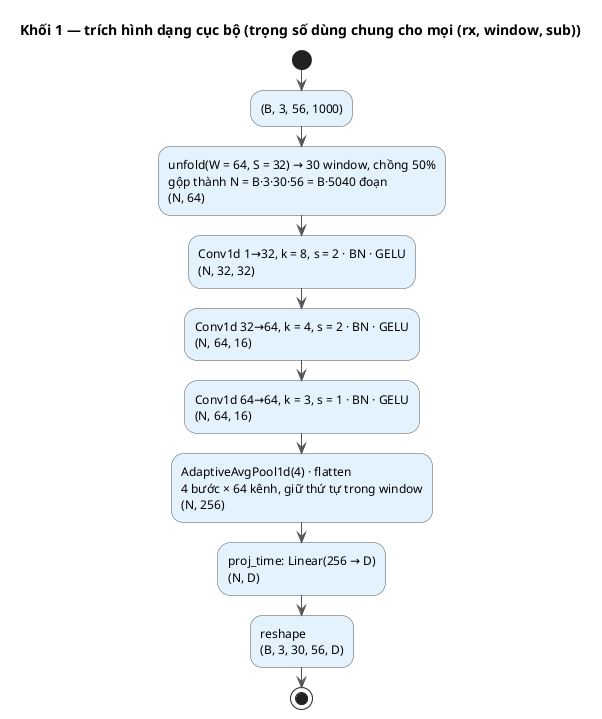
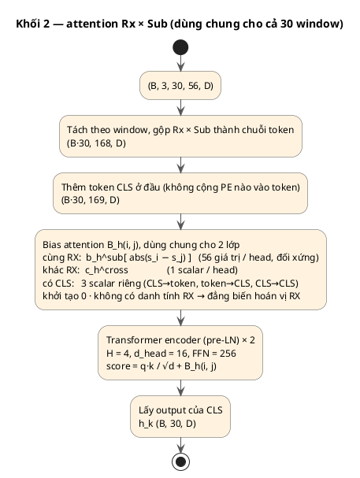
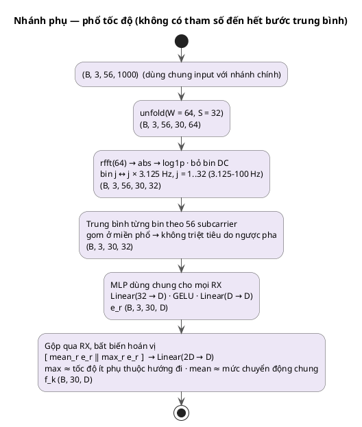
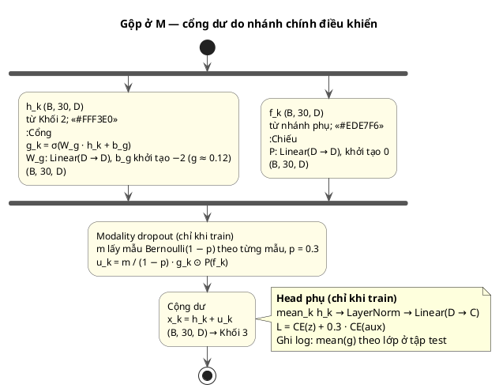

# WiFormer v3 — Lập luận thiết kế

> Nhánh: `arch_v3` · Trạng thái: **đã code** (`models/wiformer_v3.py`, model `wiformer_v3`), chưa chạy thực nghiệm (cập nhật 2026-11-15)
> Dữ liệu tham chiếu: SSHAR-ESP, 3 RX × 56 subcarrier × 1000 điểm (5 s, 200 Hz). Code hỗ trợ cả UT-HAR (mục 16).
>
> **Cửa sổ:** độ dài cửa sổ tính theo giây, không quá 0.3 s: `W = floor(0.3 · fs)` (làm chẵn), stride `W/2`. Với SSHAR-ESP: **W = 60 (0.30 s), stride 30, n_win = 32, phổ 30 bin (3.33–100 Hz, 3.33 Hz/bin)**. Các hình và bảng phía dưới được tính với W = 64 (30 window, 32 bin); cấu trúc không đổi, chỉ khác các kích thước này. Số tham số đo thực tế của `v3_full` trên SSHAR-ESP là **462,184** (gồm head phụ 648).
>
> **Chia dữ liệu:** SSHAR-ESP dùng split `repeat622` (6:2:2 theo lần lặp): `dir00` rep 1–6 / 7–8 / 9–10, `dir01`/`dir02` rep 1–3 / 4 / 5 (cả hai hướng); mỗi (người, hành động) 48 / 16 / 16, tổng 3840 / 1280 / 1280; tập test trùng với protocol 7:1:2. UT-HAR dùng split có sẵn của dataset (X_train / X_val / X_test).
> Nhãn: 0 ngồi xuống · 1 đứng lên · 2 cúi nhặt · 3 ngã · 4 nằm im · 5 đi · 6 chạy · 7 phòng trống.

---

## 1. Quan sát xuất phát

Kết quả ablation (SSHAR-ESP, split theo repeat, seed 42) cho thấy lỗi phân loại không phân bố đều mà tập trung theo cặp. Mỗi cặp hỏng vì thiếu một loại thông tin khác nhau:

| Cặp nhầm | Thiếu thông tin gì | Chỉ nhánh thời gian (`wo_fft`) | Thêm FFT, gộp concat (`full`) |
|---|---|---|---|
| 5 đi ↔ 6 chạy | **Tốc độ**. Hình thái giống nhau: chuyển động tuần hoàn của toàn thân | 22 lỗi | 7 |
| 4 nằm im ↔ 7 phòng trống | **Có hay không có vi chuyển động** | 22 | 14 |
| 0 ngồi xuống / 1 đứng lên / 2 cúi nhặt | **Thứ tự và hình dạng diễn biến** theo thời gian | 11 | 24 ↑ |

Thông tin tần số không tốt hay xấu một cách tuyệt đối: nó có ích cho một số lớp và có hại cho một số lớp khác. Kiến trúc cần biết **khi nào** nên dùng nó.

## 2. Hai miền mang hai loại bất biến trái ngược nhau

**Phổ biên độ bất biến với dịch thời gian.** Dịch chuỗi trong window chỉ làm đổi pha của phổ, không làm đổi độ lớn.
- Với hành động **tuần hoàn** như đi và chạy, đây là ưu điểm. Một window 0.32 s rơi vào pha bất kỳ của chu kỳ bước, nên nhánh thời gian thấy các hình dạng khác nhau tùy chỗ cắt, còn phổ thì ổn định.
- Tần số dao động biên độ tỉ lệ với tốc độ thay đổi chiều dài đường phản xạ, f ≈ (dL/dt)/λ, nên phổ mã hóa trực tiếp **tốc độ**, đúng thứ phân biệt đi với chạy.

**Phổ biên độ cũng bất biến với đảo chiều thời gian.** Với tín hiệu thực, |FFT(x(−t))| = |FFT(x(t))|.
- Ngồi xuống và đứng lên gần như là cùng một chuyển động chạy theo hai chiều ngược nhau. **Về nguyên lý, phổ không thể phân biệt được hai hành động này.** Cúi nhặt cũng có dải tốc độ tương tự.
- Với nhóm này, thông tin phân biệt nằm ở **thứ tự** và hình dạng, tức là ở miền thời gian.

**Hệ quả.** Khi gộp bình đẳng, mỗi token ở nhóm 0/1/2 nhận thêm một nửa nội dung **giống nhau giữa các lớp**, và thành phần này pha loãng phần thông tin phân biệt. Không phải mô hình "thiếu tự tin". Đúng hơn, phép gộp **bắt** mọi lớp mang theo một thành phần mà với một số lớp là nhiễu có cấu trúc.

## 3. Nguyên lý thiết kế: chứng cứ phân cấp

- **Cấp 1, hình thái theo thời gian:** xác định loại chuyển động (tư thế chuyển tiếp, tuần hoàn, tĩnh hay đột ngột). Thông tin này luôn cần thiết và đủ để phân biệt phần lớn các lớp.
- **Cấp 2, phổ / tốc độ:** chỉ dùng để tinh chỉnh **bên trong** những nhóm mà hình thái không đủ để phân biệt.

Kiến trúc gồm một **nhánh chính** giữ nguyên toàn vẹn, và một **nhánh phụ** chỉ được cộng vào khi nhánh chính "cho phép".

```
x (B, R, S, T) ─ trừ mean theo (rx, sub), chia std chung theo (mẫu, rx)              mục 9
 ├─ Khối 1 (Conv1d) → Khối 2 (attention Rx×Sub, bias |Δsub| trong cùng RX,
 │                            bias riêng cho cặp khác RX, CLS tách vị trí) → h_k   (B, n_win, D)   nhánh chính, mục 10
 └─ unfold W → rfft → log1p|X| → bỏ DC → trung bình theo S → phổ mỗi RX
        → MLP dùng chung cho mọi RX → [mean_r ‖ max_r] → Linear → f_k         (B, n_win, D)   nhánh phụ
 x_k = h_k + g_k ⊙ P(f_k),   g_k = σ(W_g · h_k + b_g)                          gộp ở M
 → Khối 3 (Transformer thời gian, bias vị trí tương đối có dấu, CLS tách khỏi vị trí) → classifier
 (+ head phụ trên mean_k h_k khi train)
```

Kiến trúc đầy đủ từ tổng quan đến chi tiết, kèm hình PlantUML, ở mục 12. Ước lượng tham số và FLOPs ở mục 13.

## 4. Nhánh chính: hình thái theo thời gian

Giữ nguyên ba khối của WiFormer, chỉ bỏ phần FFT khỏi Khối 1:
- **Khối 1 (Conv1d trên từng đoạn subcarrier × window):** trích hình dạng cục bộ có thứ tự. `flat4` giữ trật tự bên trong window, nên phân biệt được tăng hay giảm.
- **Khối 2 (attention Rx × Sub trong mỗi window):** tổng hợp trạng thái không gian của window k thành `h_k`. Đây là bản tóm tắt "toàn thân đang làm gì" trong 0.32 s đó. Mã hóa vị trí của khối này được thay đổi trong v3, xem mục 10.
- **Khối 3 (Transformer thời gian):** mô hình hóa diễn biến giữa các window. Mã hóa vị trí của khối này được thay đổi trong v3, xem mục 11.

## 5. Nhánh phụ: phổ tốc độ theo window

**Các bước** (shape cho một mẫu SSHAR-ESP):

| Bước | Thao tác | Shape |
|---|---|---|
| 0 | Input sau chuẩn hóa (mục 9, dùng chung với nhánh chính) | (3, 56, 1000) |
| 1 | `unfold(64, 32)`, cùng cách cắt với Khối 1 | (3, 56, 30, 64) |
| 2 | `rfft` → `log1p\|X\|` → bỏ bin DC; bin j ứng với j × 3.125 Hz, j = 1..32 (3.125–100 Hz) | (3, 56, 30, 32) |
| 3 | Trung bình từng bin theo 56 subcarrier: `spec[r,k,j] = (1/56) Σ_s log1p\|X[r,s,k,j]\|` | (3, 30, 32) |
| 4 | Mỗi phổ RX qua cùng một MLP: `Linear(32, D) → GELU → Linear(D, D)` → `e_r` | (3, 30, D) |
| 5 | Gộp qua RX: `[mean_r e_r ‖ max_r e_r]` → `Linear(2D, D)` | (30, D) = `f_k` |

**Trung bình phổ theo subcarrier, giữ riêng từng RX:**
- **Lý do gom:** tốc độ là thuộc tính của cơ thể, không phải của subcarrier. Mọi subcarrier của một liên kết đều quan sát **cùng các tần số dao động**, chỉ khác biên độ và pha do fading đa đường. Lấy độ lớn phổ loại bỏ phần pha khác nhau đó. Trung bình trên 56 subcarrier là ước lượng của **nội dung tốc độ chung**.
- **Lý do gom ở miền phổ chứ không ở miền tín hiệu:** các subcarrier có thể dao động ngược pha. Ví dụ sub A dao động `+sin(20 Hz)`, sub B dao động `−sin(20 Hz)`: trung bình tín hiệu bằng 0 và mất chuyển động, còn trung bình độ lớn phổ vẫn giữ đỉnh ở 20 Hz.
- **Lý do lấy log trước khi trung bình:** fading tác động kiểu nhân lên biên độ. Lấy log biến nó thành độ lệch cộng, nên trung bình phản ánh **hình dạng phổ** thay vì bị subcarrier có độ lợi lớn chi phối.
- **Lý do xử lý riêng từng RX trước khi gộp:** mỗi liên kết có hình học khác nhau. Tốc độ thay đổi đường truyền là thành phần vận tốc **theo hướng của liên kết đó**. Ba phổ là ba hình chiếu khác nhau của cùng một chuyển động, nên không trộn phổ trước khi mã hóa.

**Gộp qua RX bằng MLP dùng chung và `[mean ‖ max]`, không ghép theo thứ tự:**
- **Ghép theo thứ tự cố định là danh tính RX.** Nếu ghép `[phổ RX1 ‖ phổ RX2 ‖ phổ RX3]` rồi qua MLP, trọng số MLP gắn cứng với từng vị trí, nên MLP biết phổ nào đến từ RX nào. Ví dụ lối tắt: trong tập train, người hay chạy theo hướng làm RX2 thấy tần số cao nhất, MLP học "RX2 tần số cao → chạy"; khi test với hướng khác thì lối tắt sai. Điều này trái với triết lý bất biến hoán vị RX (mục 10).
- **MLP dùng chung** chỉ học "phổ này nói gì về chuyển động", không học "phổ này của RX nào". **Mean và max** không đổi khi hoán vị RX. Đây là cấu trúc chuẩn cho dữ liệu dạng tập hợp (DeepSets, Zaheer et al., NeurIPS 2017).
- **Ý nghĩa vật lý của max:** mỗi liên kết chỉ đo được thành phần vận tốc theo hướng của nó, nên tần số mỗi RX thấy luôn ≤ tần số ứng với tốc độ thật. RX thấy tần số cao nhất là RX thẳng hàng nhất với hướng di chuyển. Lấy max qua RX cho ước lượng tốc độ **ít phụ thuộc hướng đi nhất**, quan trọng vì đi và chạy trong SSHAR có hai hướng (`dir01`, `dir02`).
- **Ý nghĩa của mean:** mức chuyển động chung mà mọi liên kết đều thấy, có ích cho cặp 4 nằm im ↔ 7 phòng trống, nơi không có hướng di chuyển nổi trội.

**Tính theo từng window, không tính trên cả mẫu:**
- Tốc độ thay đổi theo thời gian (bắt đầu, tăng tốc, dừng; cú ngã là một xung tốc độ).
- `f_k` được căn cùng window với `h_k`, nên phép điều kiện hóa ở mục 7 diễn ra **tại cùng một thời điểm**.
- Diễn biến của phổ qua các window (ví dụ nhịp bước) được Khối 3 mô hình hóa sau khi gộp.

## 6. Gộp ở vị trí M (giữa Khối 2 và Khối 3)

**Không gộp sớm (Khối 1).** Một token ở Khối 1 chỉ là một subcarrier trong 0.32 s. Câu hỏi "có cần tham khảo tốc độ không" phụ thuộc vào **loại chuyển động của toàn thân**, và một token đơn lẻ không chứa thông tin đó. Quyết định ở mức này là bài toán đặt sai.

**Không gộp muộn (sau Khối 3).** Diễn biến tốc độ theo thời gian cũng mang thông tin, ví dụ nhịp bước của đi và chạy hay xung của cú ngã. Nếu gộp sau Khối 3, phổ chỉ còn là một vector tĩnh và mất khả năng được mô hình hóa theo thời gian.

**Gộp ở M.** `h_k` đã là bản tóm tắt trạng thái toàn thân của window k, nên đây là **mức trừu tượng thấp nhất mà quyết định "có cần tốc độ" đã có nghĩa**. Đồng thời, Khối 3 vẫn có thể khai thác diễn biến của phần tốc độ đã được gộp.

## 7. Cơ chế gộp: cộng dư, cổng do nhánh chính điều khiển

```
x_k = h_k + g_k ⊙ P(f_k),     g_k = σ(W_g · h_k + b_g)
```

**Cộng dư thay vì tổ hợp lồi.**
- Concat + Linear, tỉ lệ α/(1−α) hay softmax đều buộc hai nguồn **chia nhau một ngân sách biểu diễn**: tăng phần tần số đồng nghĩa với giảm phần thời gian.
- Cộng dư giữ `h_k` nguyên vẹn. Tần số chỉ là một **số hạng hiệu chỉnh**. Với nhóm 0/1/2, chỉ cần g → 0 là mô hình trở về đúng nghiệm time-only.

**Cổng chỉ phụ thuộc `h_k`, không phụ thuộc `f_k`.**
- Đây là hiện thực trực tiếp của nguyên lý phân cấp: **hình thái quyết định có hỏi tốc độ hay không**.
- Nếu cổng nhìn vào `f_k`, phổ sẽ tự quyết định tầm quan trọng của chính nó. Với nhóm 0/1/2, nơi phổ giống nhau giữa các lớp, phổ không thể tự nhận ra rằng nó vô ích.

**Cổng tự học thay vì quy tắc cứng "tĩnh/động".** Dữ liệu cho thấy tần số cũng giúp cặp **tĩnh** 4↔7. Một quy tắc chia theo nhóm di chuyển sẽ đóng nhầm kênh này. Cổng học được sẽ tự tìm ra những lớp nào cần tần số.

## 8. Ràng buộc để nhánh phụ thực sự là thứ cấp

Cổng chỉ **cho phép** quan hệ phân cấp, nó không **bảo đảm** quan hệ đó. Khi tối ưu tự do, hai nhánh có thể đồng thích nghi, khiến nhánh thời gian trở nên phụ thuộc vào tần số.

1. **Khởi tạo `P` bằng 0, `b_g` âm (−2, g₀ ≈ 0.12).** Quá trình học xuất phát **đúng từ nghiệm time-only**. Tần số chỉ được đưa vào trong chừng mực nó làm giảm loss: mô hình đi từ giả thuyết đơn giản nhất và chỉ thêm chứng cứ thứ cấp khi cần.
2. **Modality dropout (p = 0.3).** Ngẫu nhiên bỏ hẳn `P(f_k)` của một mẫu khi train. Nhánh thời gian phải tự phân loại được, nên không thể dựa vào tần số để bù cho phần nó lẽ ra phải học.
3. **Head phụ trên `h` (deep supervision, λ = 0.3).** `L = CE(z) + λ · CE(head(mean_k h_k))`. Biến yêu cầu "nhánh chính tự đúng" thành một **mục tiêu huấn luyện tường minh** thay vì chỉ là kỳ vọng.

## 9. Chuẩn hóa đầu vào: trừ mean theo subcarrier, chia std chung theo RX

### 9.1 Vấn đề của z-score theo (rx, sub) ở v2

v2 chuẩn hóa mỗi subcarrier về mean 0, std 1 trên cả mẫu. Ví dụ một RX có 2 subcarrier:
- **Sub A (nhạy):** mức tĩnh 10, dao động ±2 do người chuyển động.
- **Sub B (không nhạy):** mức tĩnh 30, chỉ có nhiễu ±0.2.

Thông tin cần giữ là **A dao động mạnh gấp 10 lần B**.

| Cách | Làm gì | Sub A thành | Sub B thành | Vấn đề |
|---|---|---|---|---|
| **v2:** z-score theo (rx, sub) | Mỗi sub trừ mean và chia std của chính nó | 0 ± 1.4 | 0 ± 1.4 | Nhiễu của B bị **khuếch đại** ngang chuyển động của A, mất tỉ lệ 10:1 |
| Mean và std chung cho cả RX | Trừ một mean chung (≈ 20), chia một std chung (≈ 10) | −1 ± 0.2 | +1 ± 0.02 | Còn tỉ lệ 10:1, nhưng **mức tĩnh lớn gấp 5 lần dao động**, chuyển động bị chìm |
| **v3:** mean riêng từng sub, std chung cho RX | Mỗi sub trừ mean của chính nó (A: 0 ± 2, B: 0 ± 0.2), rồi chia một std chung của RX (≈ 1.4) | 0 ± 1.4 | 0 ± 0.14 | Bỏ hết mức tĩnh, **giữ đúng tỉ lệ 10:1** |

Hệ quả của cách làm v2:
- Ý chính của Khối 2 là chọn ra subcarrier nhạy trong từng window, nhưng **độ mạnh tương đối giữa các subcarrier**, đầu mối trực tiếp nhất cho việc chọn này, đã bị xóa trước khi vào mô hình.
- Có thể là một nguyên nhân của lỗi 4 nằm im ↔ 7 phòng trống: hai lớp này khác nhau chủ yếu ở **mức** dao động, nhưng sau z-score cả hai đều thành chuỗi có std = 1. Đây là giả thuyết, chưa kiểm chứng.
- Nhánh tần số cũng bị ảnh hưởng: mọi phổ được tính trên tín hiệu đã bị cân bằng năng lượng.

### 9.2 Thiết kế v3

```
x̃[r, s, t] = (x[r, s, t] − mean_t x[r, s, ·]) / std_{s,t}( x[r, ·, ·] sau khi trừ mean )
```

- **Trừ mean riêng cho từng (rx, sub):** mức tĩnh mỗi subcarrier khác nhau do fading chọn lọc tần số, và chỉ phản ánh đường truyền tĩnh (tường, đồ vật, vị trí người), không chứa chuyển động. Giữ lại thì nó thành "dấu vân tay" của phòng và vị trí, mô hình có thể học thuộc nó thay vì học hành động.
- **Chia một std chung cho mỗi (mẫu, rx):** giữ được độ mạnh dao động tương đối giữa các subcarrier, tức thông tin "subcarrier nào nhạy". Nhánh tần số cũng giữ được mức năng lượng.
- **Vẫn chia riêng theo từng RX:** mỗi ESP32 có độ lợi (AGC, anten) khác nhau. Chia std theo RX loại bỏ khác biệt phần cứng giữa các thiết bị.

## 10. Khối 2: bias tương đối theo subcarrier, quan hệ cùng/khác RX

### 10.1 Hai vấn đề của PE ở Khối 2 (v2)

v2 cộng PE_sub tuyệt đối (`Embedding(56, D/2) → Linear`) vào mỗi token, dùng chung cho cả 3 RX, không có PE_rx.

**PE_sub tuyệt đối có thể học thuộc "subcarrier nào quan trọng".**
- PE tuyệt đối có lý do: subcarrier k luôn ứng với cùng một tần số.
- Nhưng subcarrier nào nhạy lại phụ thuộc vị trí người và hình học đa đường, thay đổi giữa người, vị trí và lần đo. PE tuyệt đối cho phép mô hình ghi nhớ "sub 23 quan trọng" theo tập train, nên có nguy cơ khái quát kém khi split theo user hoặc position.
- Thứ ổn định về mặt vật lý là **cấu trúc tương quan**: hai subcarrier càng gần nhau về tần số thì càng tương quan (băng thông kết hợp). Cấu trúc này chỉ phụ thuộc |Δf| và **đối xứng là đúng**, khác với trục thời gian. PA-TCNet (ICAACE 2026) dùng đúng dạng `f(|i − j|)` trên trục subcarrier.

**Bias theo |Δsub| chỉ có nghĩa trong cùng một RX.**
- Sub 10 và sub 11 của RX1 tương quan cao vì cùng kênh và gần nhau về tần số. Sub 10 của RX1 và sub 11 của RX2 không hề "gần nhau", vì là hai kênh truyền hoàn toàn khác.
- Nếu áp một bảng bias theo |Δsub| cho mọi cặp token, mô hình nhận một giả định vật lý sai. Vì vậy attention cần biết hai token **cùng hay khác RX**.

### 10.2 Phân biệt RX có mâu thuẫn với triết lý ban đầu?

Triết lý v2 ([WiFormer_Architecture.md](WiFormer_Architecture.md), mục 1.2 và 7): không dùng PE_rx để mô hình **không biết token đến từ RX nào**. Người có thể đứng ở bất kỳ đâu, nên cùng một hành động ở vị trí khác sẽ làm một RX khác "sáng lên". Có danh tính RX thì mô hình có thể học lối tắt "RX2 sáng → hành động X". Nói gọn, triết lý là **bất biến với hoán vị RX**, phục vụ khái quát hóa theo vị trí.

| Loại thông tin RX | Ví dụ | Bất biến hoán vị RX? | Mâu thuẫn với triết lý? |
|---|---|---|---|
| **Danh tính tuyệt đối** | PE_rx: "token này thuộc RX2" | ✗ | **Có**, mở lại lối tắt theo vị trí. Không dùng |
| **Quan hệ** | Bias "hai token cùng RX hay khác RX" | ✓ Đổi nhãn RX thì quan hệ cùng/khác không đổi | **Không** |

v3 chỉ dùng thông tin **quan hệ**, nên giữ nguyên triết lý.

### 10.3 Thiết kế v3

```
score_h(i, j) = q_i · k_j / √d + B_h(i, j)

B_h(i, j) = b_h^sub[|s_i − s_j|]   nếu i, j cùng RX        (56 giá trị/head, đối xứng)
          = c_h^cross              nếu i, j khác RX        (1 scalar/head)
          = 3 scalar riêng         nếu có CLS (CLS→token, token→CLS, CLS→CLS)
```

- **Đối xứng theo |Δs|:** tương quan giữa các subcarrier chỉ phụ thuộc |Δf|, không có chiều.
- **Một scalar cho cặp khác RX:** giữa các RX không có cấu trúc khoảng cách nào để mã hóa. Scalar này chỉ cho phép mỗi head chọn tập trung vào bên trong một liên kết hay vào quan hệ giữa các liên kết.
- **CLS tách khỏi vị trí**, giống Khối 3 (mục 11).
- **Bỏ PE_sub tuyệt đối** (giữ lại làm ablation).
- **Khởi tạo toàn bộ bias bằng 0.**
- Cần kiểm tra: 56 subcarrier của ESP32 có bị gián đoạn ở DC (chỉ số −1 → 1) không. Nếu có, |Δs| phải tính theo chỉ số tần số thật, không theo thứ tự trong mảng.

**Hệ quả với toàn mô hình.** Khối 2 vẫn **đẳng biến với hoán vị RX**, nên `h_k` vẫn **bất biến**. Cổng `g_k = σ(W_g h_k)` và Khối 3 vì vậy không bị ảnh hưởng. Cùng với cách gộp RX đối xứng ở nhánh tần số (mục 5), **toàn bộ mô hình bất biến với hoán vị RX**. Đây là một tính chất kiểm chứng được: hoán vị thứ tự RX lúc test thì dự đoán không đổi.

### 10.4 Tiền lệ

Cơ chế đều đã có tiền lệ ở lĩnh vực khác. Áp dụng vào CSI sensing thì chưa thấy (tìm kiếm sơ bộ).

| Thành phần | Tiền lệ | Nội dung |
|---|---|---|
| Quan hệ cùng/khác nhóm thay cho danh tính nhóm | **XLNet** (Yang et al., NeurIPS 2019), *relative segment encoding* | Thay segment embedding tuyệt đối của BERT bằng việc chỉ mã hóa hai vị trí cùng hay khác segment, để khái quát tốt hơn và dùng được với số segment tùy ý |
| Cặp khác nhóm không có khoảng cách tương đối | **R2D2** (arXiv 2105.04645) | Trong cùng segment, vị trí tương đối là hiệu chỉ số; giữa các segment khác nhau không có vị trí chung, phải định nghĩa riêng |
| Bias theo khoảng cách, giá trị đặc biệt cho cặp "không nối", bias riêng cho token tổng hợp | **Graphormer** (Ying et al., NeurIPS 2021), *spatial encoding* | Bias học được theo khoảng cách đường đi ngắn nhất, giá trị riêng cho cặp nút không liên thông, bias riêng cho virtual node (tương đương CLS) |
| Bias đối xứng theo \|Δ\| trên trục subcarrier | **PA-TCNet** (ICAACE 2026) | `f(\|i − j\|)` theo subcarrier, không xử lý nhiều RX |
| Gộp bất biến hoán vị qua các thiết bị thu | Định vị WiFi (arXiv 2602.16762), Set Transformer trên RSSI (arXiv 2506.00656) | Encoder dùng chung cho từng thiết bị, rồi gộp bất biến hoán vị |

Cách trình bày: cơ chế kế thừa XLNet và Graphormer; phần đóng góp riêng là lập luận vật lý cho CSI (tương quan theo |Δf| chỉ tồn tại trong cùng một kênh; bất biến hoán vị RX để khái quát theo vị trí).

## 11. Mã hóa vị trí ở Khối 3: bias tương đối có dấu, tách CLS

### 11.1 Các bài CSI gần đây mã hóa vị trí như thế nào

Tổng hợp sơ bộ (2026-11), chủ yếu dựa trên phần tóm tắt, chưa đọc hết toàn văn:

| Nhóm | Cách mã hóa | Bài tiêu biểu |
|---|---|---|
| Tuyệt đối (sinusoid / học được) | Cộng PE vào token theo thứ tự thời gian | WiSigPro (ESWA 2024), MDA-CSI (Wireless Days 2025), WiFlexFormer (arXiv 2411.04224) |
| Gaussian range encoding | Mỗi vị trí biểu diễn bằng nhiều khoảng Gaussian; vẫn là PE tuyệt đối | THAT (AAAI 2021), ConSense (arXiv 2502.17483) |
| Tuyệt đối học được trên patch nhiều trục | Patch thời gian × subcarrier (× anten) kiểu ViT | MAE-ViT zero-shot (arXiv 2511.18792), WiFo (arXiv 2412.08908), baseline của CSI-Bench (NeurIPS 2025) |
| Tương đối bằng RoPE | Xoay q, k; attention phụ thuộc độ lệch có dấu | Adaptive 3D-RoPE (arXiv 2605.00968), ConsisFormer (arXiv 2606.19953); đều là mô hình nền tảng không dây, không phải HAR |
| Tương đối đối xứng học được | `f(\|i − j\|)` theo trục subcarrier | PA-TCNet (ICAACE 2026) |

Nhận xét:
- Các bài **HAR** chủ yếu dùng PE **tuyệt đối**. Mã hóa tương đối mới xuất hiện ở các mô hình nền tảng không dây, chủ yếu qua RoPE, tức là **có dấu**.
- Không thấy bài CSI nào dùng ALiBi. Cách Khối 3 của WiFormer v2 đang làm (ALiBi đối xứng trong encoder hai chiều) không có tiền lệ trong mảng này.
- Chưa thấy bài CSI HAR nào dùng bias tương đối học được kiểu T5/Swin cho trục thời gian. Đây mới là kết quả tìm kiếm sơ bộ, cần tìm kỹ trước khi khẳng định.

### 11.2 Hai vấn đề của ALiBi đối xứng ở Khối 3 (v2)

Khối 3 của v2 cộng `−m_h · |i − j|` vào điểm attention trên toàn chuỗi `[CLS, w_1, …, w_30]`.

**Vấn đề 1: đối xứng nên mất chiều thời gian.**
- Bias chỉ phụ thuộc |i − j|. Window đứng trước và window đứng sau với cùng khoảng cách nhận bias giống hệt nhau.
- ALiBi gốc (Press et al., 2022) dùng cho decoder causal, nơi mask causal ngầm định chiều. Đưa sang encoder hai chiều với |i − j| thì chiều bị mất. Nếu bỏ CLS, Khối 3 đẳng biến với phép đảo thứ tự window.
- Với HAR, đây là điểm then chốt: như mục 2, ngồi xuống và đứng lên gần như là ảnh đảo thời gian của nhau. Conv `flat4` giữ được chiều **trong** một window, nhưng chiều **giữa** các window thì Khối 3 không thấy. Wang et al. (ICLR 2021) và iRPE (Wu et al., ICCV 2021) cũng chỉ ra rằng mã hóa đối xứng không phân biệt được trước và sau, và dạng có hướng cho kết quả tốt hơn.

**Vấn đề 2: CLS chịu bias vị trí nên làm rò vị trí tuyệt đối.**
- CLS đặt ở vị trí 0, nên khoảng cách CLS → window j chính là j. Với `k3_heads = 4`, slope = 2^(−2h):

| Head | Slope | Bias CLS → window 30 | Trọng số tương đối so với window 1 |
|---|---|---|---|
| 1 | 0.25 | −7.5 | ≈ 0.07% |
| 2 | 0.0625 | −1.9 | ≈ 16% |
| 3 | 0.0156 | −0.47 | ≈ 63% |
| 4 | 0.0039 | −0.12 | ≈ 89% |

- Phần đọc ra của CLS bị lệch về các window đầu, trong khi hành động có thể xảy ra ở bất kỳ đâu trong 5 s. Đồng thời, nguồn thông tin chiều duy nhất của Khối 3 lại chính là sự rò rỉ vị trí tuyệt đối này.
- TUPE (Ke et al., ICLR 2021) lập luận rằng CLS không nên có quan hệ vị trí với các token khác và đề xuất tách CLS khỏi vị trí.

### 11.3 Thiết kế v3

```
score_h(i, j) = q_i · k_j / √d + B_h(i, j)

B_h(i, j) = b_h[i − j]        nếu i, j đều là window   (i − j ∈ {−29, …, 29})
          = c_h^{CLS→w}       nếu i = CLS, j là window
          = c_h^{w→CLS}       nếu i là window, j = CLS
          = c_h^{CLS→CLS}     nếu i = j = CLS
```

- **Bias tương đối có dấu, học được, kiểu T5 / Swin** (Raffel et al., JMLR 2020; Liu et al., ICCV 2021). Mỗi head có một bảng 2·30 − 1 = 59 giá trị, không cần chia bucket vì n_win cố định và ngắn. Bảng này dùng chung cho mọi lớp của Khối 3 như T5, nên mỗi head có một hình bias duy nhất để phân tích.
- **CLS tách khỏi vị trí, kiểu BEiT** (Bao et al., ICLR 2022): 3 scalar riêng cho mỗi head, không phụ thuộc vị trí. CLS nhìn mọi window ngang nhau về mặt vị trí, nên hết thiên lệch về đầu chuỗi.
- **Khởi tạo toàn bộ bias bằng 0.** Lúc đầu Khối 3 không có thông tin vị trí và hoàn toàn đối xứng. Mọi bất đối xứng xuất hiện sau khi train đều do dữ liệu đòi hỏi.
- **Lý do chọn T5 thay vì RoPE:** cả hai đều tương đối và có dấu. Ưu điểm của ALiBi là ngoại suy độ dài, không cần ở đây vì n_win luôn bằng 30. Bảng bias của T5 **đọc trực tiếp được**: vẽ `b_h[+d]` và `b_h[−d]` theo d cho thấy mô hình có học được thông tin chiều hay không. Với RoPE, thông tin vị trí bị trộn vào q, k nên khó minh họa như vậy.

**Cách trình bày trong bài:** không trình bày là "đề xuất dùng T5 bias". Trình bày theo trình tự: phân tích vấn đề của ALiBi đối xứng với HAR (mất chiều, rò vị trí qua CLS) → dùng bias có dấu và tách CLS → ablation và hình bias đã học xác nhận.

## 12. Kiến trúc từ tổng quan đến chi tiết

Shape ghi theo SSHAR-ESP: R = 3 RX, S = 56 subcarrier, T = 1000, W = 64, stride 32, n_win = 30, D = 64, H = 4 head, FFN = 256, C = 8 lớp. Màu: xanh dương = nhánh chính, cam = Khối 2, tím nhạt = nhánh phụ, vàng = gộp, xanh lá = Khối 3, hồng = classifier.

### 12.1 Bảng tóm tắt

| Thành phần | Vai trò | Thay đổi so với v2 | Mục lập luận |
|---|---|---|---|
| Tiền xử lý | Bỏ mức tĩnh, giữ độ mạnh tương đối giữa subcarrier | Trừ mean theo (rx, sub), chia std chung theo (mẫu, rx) | 9 |
| Khối 1 | Hình dạng cục bộ có thứ tự của từng (rx, sub, window) | Chỉ còn nhánh Conv1d, bỏ FFT và `fuse` | 4 |
| Khối 2 | "Bức tranh không gian" `h_k` của từng window | Bias \|Δsub\| trong cùng RX + scalar cho cặp khác RX + CLS tách vị trí, bỏ PE_sub tuyệt đối | 10 |
| Nhánh phụ | Phổ tốc độ `f_k` của từng window | Mới: phổ trung bình theo sub, MLP dùng chung cho mọi RX, gộp `[mean ‖ max]` | 5 |
| Gộp ở M | Cộng tốc độ vào `h_k` khi hình thái cho phép | Mới: cổng dư do `h_k` điều khiển, zero-init, modality dropout | 6, 7, 8 |
| Khối 3 | Diễn biến giữa các window | Bias T5 có dấu + CLS tách vị trí, thay ALiBi đối xứng | 11 |
| Head phụ | Ép nhánh chính tự phân loại được | Mới, chỉ dùng khi train | 8 |

### Hình 1 — Tổng quan

```plantuml
@startuml
skinparam defaultFontName Arial
skinparam ActivityBorderColor #555555
skinparam ArrowColor #555555
title WiFormer v3 — tổng quan

start
:CSI biên độ đầu vào
(B, R·N_ant·S, T = 1000);
:Tiền xử lý (Hình 2)
chọn anten[0] · trừ mean theo (rx, sub) · chia std theo (mẫu, rx)
(B, R = 3, S = 56, T = 1000);
fork
  :<b>Nhánh chính</b>
  Khối 1 — Conv1d trên từng (rx, sub, window) (Hình 3)
  (B, 3, 30, 56, D); <<#E3F2FD>>
  :Khối 2 — attention Rx × Sub trong từng window (Hình 4)
  bias theo abs(Δsub) trong cùng RX · scalar cho cặp khác RX · CLS tách vị trí
  h_k (B, 30, D); <<#FFF3E0>>
fork again
  :<b>Nhánh phụ</b> (Hình 5)
  phổ log của từng (rx, sub, window) → trung bình theo sub
  → MLP dùng chung cho mọi RX → [mean ‖ max] qua RX
  f_k (B, 30, D); <<#EDE7F6>>
end fork
:Gộp ở M (Hình 6)
x_k = h_k + g_k ⊙ P(f_k),  g_k = σ(W_g h_k + b_g)
(B, 30, D); <<#FFFDE7>>
:Khối 3 — Transformer thời gian (Hình 7)
bias T5 có dấu · CLS tách vị trí · 6 lớp
(B, D); <<#E8F5E9>>
:Classifier
LayerNorm · Dropout · Linear(D → C)
(B, C); <<#FCE4EC>>
note right
  Khi train: head phụ trên mean_k h_k
  L = CE(z) + λ·CE(aux)  (Hình 6)
end note
stop
@enduml
```

### Hình 2 — Tiền xử lý

```plantuml
@startuml
skinparam defaultFontName Arial
skinparam ActivityBorderColor #555555
skinparam ArrowColor #555555
title Tiền xử lý — chuẩn hóa giữ độ mạnh tương đối giữa subcarrier

start
:CSI biên độ
(B, R, N_ant, S, T);
:Chọn anten[0] của mỗi RX
(B, 3, 56, 1000);
:Trừ mean theo thời gian, riêng từng (rx, sub)
x'[r, s, t] = x[r, s, t] − mean_t x[r, s, ·]
→ bỏ mức tĩnh (đường truyền tĩnh, "dấu vân tay" vị trí);
:Chia một std chung cho mỗi (mẫu, rx)
x̃[r, ·, ·] = x'[r, ·, ·] / std_{s,t}(x'[r, ·, ·])
→ giữ tỉ lệ dao động giữa các sub, bỏ khác biệt độ lợi giữa các RX
(B, 3, 56, 1000);
stop
@enduml
```

### Hình 3 — Khối 1: Conv1d trên từng (rx, sub, window)



### Hình 4 — Khối 2: attention Rx × Sub trong từng window



### Hình 5 — Nhánh phụ: phổ tốc độ theo window



### Hình 6 — Gộp ở M, modality dropout và head phụ



### Hình 7 — Khối 3 và classifier

```plantuml
@startuml
skinparam defaultFontName Arial
skinparam ActivityBackgroundColor #E8F5E9
skinparam ActivityBorderColor #555555
skinparam ArrowColor #555555
title Khối 3 — Transformer thời gian với bias tương đối có dấu

start
:Chuỗi window token x_1 … x_30
(B, 30, D);
:Thêm token CLS ở đầu
(B, 31, D);
:Bias attention B_h(i, j), dùng chung cho 6 lớp
hai window:  b_h[i − j],  i − j ∈ {−29, …, 29}  (59 giá trị / head, CÓ DẤU)
có CLS:      3 scalar riêng (CLS→window, window→CLS, CLS→CLS)
khởi tạo 0 → mọi bất đối xứng trước/sau là do dữ liệu;
:Transformer encoder (pre-LN) × 6
H = 4, d_head = 16, FFN = 256
score = q·k / √d + B_h(i, j);
:Lấy output của CLS
z (B, D);
:Classifier
LayerNorm(D) → Dropout(0.1) → Linear(D → C)
(B, C); <<#FCE4EC>>
stop
@enduml
```

Một lớp Transformer encoder (pre-LN) giữ nguyên như v2, xem Hình 5 trong [WiFormer_Architecture.md](WiFormer_Architecture.md). Khác biệt duy nhất là bias `B_h(i, j)` được cộng vào điểm attention trước softmax.

## 13. Ước lượng tham số và FLOPs

Ước lượng giải tích cho **một mẫu** SSHAR-ESP (D = 64, H = 4, FFN = 256, `k2_layers = 2`, `k3_layers = 6`, `k1_conv = 3`, `flat4`, C = 8). MACs là phép nhân-cộng; FLOPs ≈ 2 × MACs. Số đếm bằng công cụ (thop/ptflops) sẽ đo lại sau khi code, và có thể lệch so với ước lượng vì công cụ đếm FFT và matmul của attention khác nhau. So sánh tương đối giữa v2 và v3 là phần đáng tin.

Một lớp Transformer encoder (D = 64, FFN = 256): attention 4·D² + 4·D = 16,640; FFN 2·D·256 + 256 + 64 = 33,088; 2 LayerNorm = 256 → **49,984 tham số**.

### 13.1 Tham số

| Thành phần | Cách tính | v2 (mặc định hiện tại) | v3 |
|---|---|---|---|
| Khối 1, nhánh Conv | 3 Conv1d + BN + `proj_time` Linear(256, 64) | 37,664 | 37,664 |
| Khối 1, nhánh FFT | `proj_freq` Linear(32, 64) | 2,112 | — |
| Khối 1, `fuse` | v2: Linear(128, 64) | 8,256 | — |
| Khối 2, encoder × 2 | 2 × 49,984 | 99,968 | 99,968 |
| Khối 2, mã hóa vị trí | v2: PE_sub = Embedding(56, 32) + Linear(32, 64). v3: (56 + 1 + 3) × 4 head | 3,904 | 240 |
| Khối 2, CLS | 64 | 64 | 64 |
| Nhánh phụ, MLP dùng chung | Linear(32, 64) + Linear(64, 64) | — | 6,272 |
| Nhánh phụ, gộp RX | Linear(128, 64) | — | 8,256 |
| Gộp ở M | W_g + P = 2 × Linear(64, 64) | — | 8,320 |
| Khối 3, encoder × 6 | 6 × 49,984 | 299,904 | 299,904 |
| Khối 3, mã hóa vị trí | v2: ALiBi không tham số. v3: (59 + 3) × 4 head | 0 | 248 |
| Khối 3, CLS | 64 | 64 | 64 |
| Classifier | LayerNorm(64) + Linear(64, 8) | 648 | 648 |
| **Tổng khi suy luận** | | **452,584** | **461,648** (+9,064, +2.0%) |
| Head phụ (chỉ khi train) | LayerNorm(64) + Linear(64, 8) | — | 648 |

### 13.2 MACs mỗi mẫu

Số đoạn ở Khối 1 và nhánh phụ: 3 RX × 56 sub × 30 window = 5,040.

| Thành phần | Cách tính | v2 | v3 |
|---|---|---|---|
| Khối 1, nhánh Conv | (8,192 + 131,072 + 196,608 + 16,384) × 5,040 | 1,775.4 M | 1,775.4 M |
| Khối 1, nhánh FFT + `fuse` | rfft (~0.8 K) + Linear(32, 64) + Linear(128, 64), × 5,040 | ~55.5 M | — |
| Khối 2 | 169 token, 2 lớp, × 30 window (≈ 23.9 M/window) | 717.7 M | 717.7 M |
| Nhánh phụ, FFT | rfft 64 điểm × 5,040 | — | ~3.9 M |
| Nhánh phụ, MLP + gộp RX | 6,144 × 90 (rx, window) + 8,192 × 30 | — | ~0.8 M |
| Gộp ở M | 2 × 4,096 × 30 | — | ~0.25 M |
| Khối 3 | 31 token, 6 lớp (≈ 1.65 M/lớp) | 9.9 M | 9.9 M |
| Classifier | — | ~0 | ~0 |
| **Tổng** | | **≈ 2.56 G MACs** (≈ 5.1 GFLOPs) | **≈ 2.51 G MACs** (≈ 5.0 GFLOPs), −2% |

### 13.3 Nhận xét

- **Nhánh phụ dùng MLP gần như không tốn chi phí:** khoảng 14.5 K tham số (3% mô hình) và dưới 1 M MACs (0.04%). Lý do là MLP chạy trên **phổ đã gom**, chỉ 90 vector mỗi mẫu (3 RX × 30 window), chứ không chạy trên 5,040 đoạn. Bản v2 chạy `proj_freq` và `fuse` trên từng đoạn trong 5,040 đoạn, tốn khoảng 55 M MACs, gấp hơn 10 lần nhánh phụ v3.
- **Tổng tham số tăng khoảng 2%**, chủ yếu do nhánh phụ và cổng. **Tổng MACs giảm khoảng 2%** vì Khối 1 bỏ phần FFT và `fuse` trên từng đoạn.
- **Phần nặng nhất vẫn là Khối 1** (khoảng 70% MACs), tiếp theo là Khối 2 (khoảng 29%). Các thay đổi của v3 không chạm vào hai phần này về mặt chi phí.
- Bias vị trí ở Khối 2 và Khối 3 chỉ có 488 tham số tổng cộng, và phép cộng bias vào điểm attention không đáng kể về MACs.

## 14. Các dự đoán kiểm chứng được

v3 được xem là một mô hình mới: mọi so sánh đều nằm **trong nội bộ v3**, không dùng lại kết quả v2. Số liệu v2 ở mục 1 chỉ là động cơ dẫn đến thiết kế.

**Kiểm bằng ablation lõi (đợt 1):**

| Giả thuyết | Kỳ vọng | Kiểm bằng |
|---|---|---|
| Nhánh tốc độ giúp các cặp cần tốc độ / vi chuyển động | Bỏ nhánh phụ làm lỗi 5↔6 và 4↔7 tăng | `v3_full` so với `wo_freq` |
| Nhánh phụ là thứ cấp, không làm hại nhóm hình thái | Bỏ nhánh phụ **không** làm lỗi 0/1/2 giảm (nhánh phụ không gây hại như v2) | `v3_full` so với `wo_freq` |
| Nhánh chính là cốt lõi | Chỉ dùng tốc độ thì kém hẳn, nhất là 0/1/2 (phổ bất biến với đảo thời gian) | `v3_full` so với `wo_main` |
| Hình dạng cục bộ có thứ tự là cần thiết | Bỏ Conv làm giảm mạnh, nhất là 0↔1 | `v3_full` so với `wo_block1` |
| Chọn (rx, sub) nhạy theo từng window là cần thiết | Bỏ attention Rx × Sub làm giảm | `v3_full` so với `wo_block2` |
| Diễn biến giữa các window là cần thiết | Bỏ Khối 3 làm giảm, nhất là 0↔1 (cần thứ tự giữa các window) | `v3_full` so với `wo_block3` |
| Cổng học đúng cấu trúc phân cấp | `mean(g)` thấp ở 0/1/2, cao ở 5/6 (và 4/7) | Log cổng theo lớp trên `v3_full`, không cần run thêm |
| Mô hình tự học được chiều thời gian | Bảng bias Khối 3 bất đối xứng: `b_h[+d] ≠ b_h[−d]` | Vẽ bảng bias của `v3_full`, không cần run thêm |
| Mô hình bất biến hoán vị RX | Hoán vị thứ tự RX lúc test, dự đoán không đổi | Kiểm tra trên `v3_full`, không cần train lại |

**Kiểm bằng ablation chi tiết (đợt sau):**

| Giả thuyết | Kỳ vọng | Kiểm bằng |
|---|---|---|
| Cổng do nhánh chính điều khiển là cần thiết | Cổng tốt hơn cộng thẳng và α tĩnh | `wo_gate`, `v3_alpha` |
| Cộng dư tốt hơn gộp cạnh tranh | Concat làm lỗi 0/1/2 tăng lại | `v3_concat` |
| Cần ràng buộc thì nhánh phụ mới thực sự thứ cấp | Bỏ zero-init / mdrop / aux làm lỗi 0/1/2 tăng lại | `wo_constraint`, `v3_no_aux`, `v3_no_mdrop` |
| Khối 3 cần thông tin chiều thời gian | Bias có dấu tốt hơn ALiBi đối xứng, nhất là ở 0↔1 | `v3_alibi` |
| Giữ mức dao động giúp tách tĩnh / trống | Lỗi 4↔7 giảm so với z-score theo sub | `v3_zsub` |
| Bias \|Δsub\| khái quát tốt hơn PE_sub tuyệt đối | Chênh lệch rõ hơn khi split theo user / position | `v3_k2_abspe` |
| Gộp RX đối xứng tốt hơn ghép theo thứ tự | Lỗi 5↔6 thấp hơn, nhất là giữa hai hướng `dir01` / `dir02` | `v3_freq_concat` |
| Chia window là cần thiết | Một window phủ cả chuỗi làm giảm | `wo_window` |

## 15. Ablation

### 15.1 Đợt 1: ablation lõi (bỏ từng khối / nhánh)

Cấu hình: SSHAR-ESP, split **`repeat622`** (6:2:2 theo lần lặp) trước, seed 42. Lệnh: `python ablation.py --model=wiformer_v3 --data_root=<...> --dataset=sshar_esp`. Mỗi biến thể bỏ đúng **một** khối hoặc nhánh, mọi phần khác giữ như `v3_full`.

| # | Tên | Bỏ gì | Thay bằng |
|---|---|---|---|
| 0 | `v3_full` | — (toàn bộ thiết kế ở mục 12) | — |
| 1 | `wo_freq` | Nhánh phụ (cùng cổng) | `x_k = h_k` |
| 2 | `wo_main` | Nhánh chính (Khối 1 + Khối 2, cổng, head phụ) | `x_k = P(f_k)` |
| 3 | `wo_block1` | Khối 1 (Conv) | `Linear(W, D)` trên đoạn thô |
| 4 | `wo_block2` | Khối 2 (attention Rx × Sub) | Trung bình 168 token mỗi window |
| 5 | `wo_block3` | Khối 3 (Transformer thời gian) | Trung bình 30 window |

6 run, khoảng 3 giờ mỗi run trên Kaggle (`wo_main` và `wo_block1` nhanh hơn nhiều vì bỏ phần nặng nhất).

Báo cáo: accuracy / F1 macro, lỗi theo cặp (5↔6, 4↔7, nội bộ 0/1/2, riêng 0↔1), `mean(g)` theo lớp, hình bảng bias Khối 3 theo head, kiểm tra hoán vị RX.

### 15.2 Để sau: ablation chi tiết

| Nhóm | Biến thể | Thay đổi so với `v3_full` |
|---|---|---|
| Cơ chế gộp | `wo_gate` | Cộng thẳng `x_k = h_k + P(f_k)` |
| | `wo_constraint` | Bỏ zero-init, mdrop và head phụ |
| | `v3_no_aux`, `v3_no_mdrop` | Bỏ riêng từng ràng buộc |
| | `v3_alpha` | Cổng thay bằng scalar α (residual kiểu Ranasingha et al., arXiv 2606.01834) |
| | `v3_concat` | Cộng dư thay bằng concat + Linear |
| | `v3_late` | Gộp sau Khối 3 |
| Mã hóa vị trí | `v3_alibi` | Khối 3 dùng ALiBi đối xứng như v2 |
| | `v3_k2_abspe` | Khối 2 dùng PE_sub tuyệt đối như v2 |
| Tiền xử lý | `v3_zsub` | Chuẩn hóa z-score theo (rx, sub) như v2 |
| Nhánh phụ | `v3_freq_concat` | Ghép phổ RX theo thứ tự |
| | `v3_agg_pca` | HPF 2 Hz + PCA PC1 (kiểu UniFi / Widar3.0) thay cho trung bình phổ |
| Cửa sổ | `wo_window` | Một window phủ cả chuỗi |
| Split | — | Chạy lại đợt 1 với split `user` |

## 16. Hỗ trợ dataset: SSHAR-ESP và UT-HAR

Code v3 phải chạy được trên cả hai dataset. Kiến trúc không đổi; các kích thước phụ thuộc dataset (số token, n_win, kích thước bảng bias, số lớp) được suy ra từ shape đầu vào.

### 16.1 So sánh hai dataset

| | SSHAR-ESP | UT-HAR |
|---|---|---|
| Phần cứng | ESP32, 1 Tx · 3 RX, mỗi RX 1 anten | Intel 5300, 1 RX × 3 anten |
| "View" trong WiFormer | 3 RX (3 thiết bị riêng) | 3 anten của **cùng một** card (`n_rx = 3` trong `WIFORMER_DATASET_CFG`) |
| Subcarrier S | 56 | 30 |
| Độ dài T | 1000 (5 s, 200 Hz) | 250 (gốc 1 kHz × 2 s = 2000 điểm, resample về 250 → **125 Hz**) |
| Cửa sổ (≤ 0.3 s) | W = 60 (0.30 s), stride 30 | W = 36 (0.288 s), stride 18 |
| n_win | 32 | 12 (phủ 234 điểm đầu, bỏ 16 điểm cuối) |
| Phổ nhánh phụ | 30 bin, 3.33–100 Hz | 18 bin, 3.47–62.5 Hz |
| Số lớp C | 8 | 7 |
| Split | `repeat` (đợt 1), sau đó `user` | Split cố định của dataset (X_train / X_val / X_test) |
| Token Khối 2 mỗi window | 168 | 90 |

### 16.2 Kích thước phụ thuộc dataset

| Thành phần | SSHAR-ESP | UT-HAR |
|---|---|---|
| Bias Khối 2 | (56 + 1 + 3) × 4 = 240 | (30 + 1 + 3) × 4 = 136 |
| Bias Khối 3 | (63 + 3) × 4 = 264 (2·32 − 1 = 63 khoảng cách) | (23 + 3) × 4 = 104 (2·12 − 1 = 23 khoảng cách) |
| Classifier, head phụ | Linear(64, 8) | Linear(64, 7) |
| **Tổng tham số đo được (gồm head phụ)** | 462,184 | 461,022 |
| **MACs mỗi mẫu (ước lượng)** | ≈ 2.6 G | ≈ 0.36 G (Khối 1 ≈ 222 M, Khối 2 ≈ 133 M, Khối 3 ≈ 4 M) |

### 16.3 Điểm khác về mặt vật lý trên UT-HAR

Trên UT-HAR, 3 "view" là 3 anten của cùng một card, đặt cách nhau khoảng nửa bước sóng. Một số lập luận viết cho 3 RX riêng của ESP cần đọc lại:

| Lập luận (viết cho ESP) | Trên UT-HAR |
|---|---|
| Chia std theo RX để bỏ khác biệt độ lợi giữa các thiết bị (mục 9) | 3 anten dùng chung AGC, nên lý do này yếu đi. Chia theo anten vẫn vô hại |
| Cặp khác RX không có cấu trúc khoảng cách theo subcarrier, dùng 1 scalar (mục 10) | **Không còn đúng hẳn:** cùng một subcarrier ở hai anten liền nhau có tần số giống hệt và tương quan cao. Scalar `c_cross` không biểu diễn được cấu trúc này. **Vấn đề mở**, xem 16.4 |
| Max qua RX ≈ tốc độ ít phụ thuộc hướng đi, vì mỗi RX là một hình chiếu khác nhau (mục 5) | 3 anten gần như cùng hình chiếu, nên max ≈ mean. Vô hại nhưng không còn lợi thế |
| Bất biến hoán vị RX (mục 10) | Vẫn đúng và vẫn hợp lý cho anten |

UT-HAR cũng có các cặp mà v3 nhắm tới: đi / chạy, ngồi xuống / đứng lên. Thứ tự nhãn của UT-HAR cần xác minh trước khi phân tích lỗi theo cặp.

### 16.4 Vấn đề mở cho UT-HAR

- **Bias cho cặp khác view ở Khối 2:** với anten của cùng card, có thể dùng một bảng riêng theo |Δsub| cho cặp khác view (`b_h^cross[|Δs|]`) thay cho một scalar. Tạm thời giữ thiết kế chung (scalar) cho cả hai dataset; xem xét lại sau khi có kết quả UT-HAR.
- **Tần số lấy mẫu của UT-HAR:** 125 Hz (bản gốc 1 kHz × 2 s, resample 2000 → 250 điểm), đã đặt mặc định trong code. Dải phổ chỉ tới 62.5 Hz, thấp hơn SSHAR-ESP (100 Hz), nên Doppler của chạy (khoảng 40–50 Hz) vẫn nằm trong dải nhưng sát biên hơn.

## 17. Ngoài phạm vi v3

- **Chọn / đánh trọng số subcarrier** (trọng số theo variance, attention pooling theo subcarrier): v3 cố ý dùng trung bình đều và chấp nhận việc subcarrier "không nhạy" làm loãng phổ. Vấn đề này dành cho một nghiên cứu riêng.
