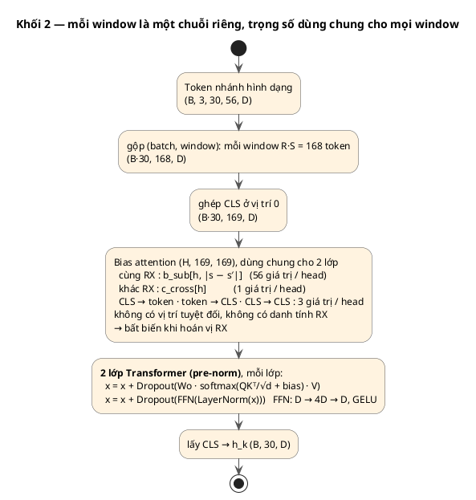
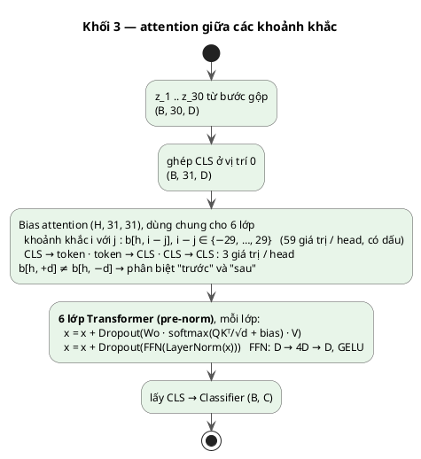

# WiFormer v5 — Mô tả kỹ thuật

Code: [models/wiformer_v5.py](models/wiformer_v5.py). Các lớp dùng chung (Conv, Khối 2, Khối 3) nằm trong [models/wiformer_v4.py](models/wiformer_v4.py).

**Tóm tắt:** một hành động là một chuỗi các khoảnh khắc ngắn, mỗi khoảnh khắc là một window khoảng 0.3 s. Trong mỗi khoảnh khắc có hai nhánh:
- **Nhánh hình dạng:** mỗi kênh (rx, sub) nhìn chuyển động theo một cách khác nhau. Nhánh này nhìn từng kênh bằng Conv, rồi gộp có chọn lọc qua attention RX × subcarrier (Khối 2), ra `h_k`.
- **Nhánh tốc độ:** tần số Doppler của cơ thể gần như giống nhau trên mọi kênh. Nhánh này lấy phổ (cửa sổ Hann) rồi trung bình qua mọi kênh, ra `a_k`.

Hai nhánh được gộp theo từng khoảnh khắc bằng một lớp **tuyến tính** `Linear(2D → D)([h_k ‖ a_k])`. Khi train có modality dropout trên nhánh hình dạng. Khối 3 đọc chuỗi khoảnh khắc theo thứ tự, dùng bias tương đối có dấu. Toàn mô hình có một classifier, loss là CE.

> **Cơ chế gộp: tuyến tính** (biến thể `full`). Gộp bằng cổng vô hướng (`gate`) đã được thử trên 5 fold và kém hơn rõ: 90.25 so với 92.90 (accuracy 6 hành động, McNemar p < 1e-4). Cổng bị sập về nhánh tốc độ, xem mục 4. `gate` giờ là một ablation.

---

## 1. Kiến trúc

Shape ghi theo SSHAR-ESP:

| Ký hiệu | Giá trị |
|---|---|
| R (số RX) | 3 |
| S (số subcarrier) | 56 |
| T | 1000 mẫu, fs = 200 Hz |
| Window W | 64 mẫu (0.32 s), stride 32 |
| K = n_win | 30 |
| Số bin phổ W/2 | 32 |
| D | 64 |
| H (số head) | 4 |
| FFN | 256 |
| C (số lớp) | 7 |

Độ dài cửa sổ W là lũy thừa của 2 gần nhất với 0.3·fs, stride bằng W/2.

| Thành phần | Vai trò | Chi tiết |
|---|---|---|
| Tiền xử lý | Chuẩn hóa theo mẫu | Chỉ giữ anten 0 của mỗi RX. Trừ mean theo thời gian cho từng (rx, sub). Chia cho một std chung của (mẫu, rx), nên tỉ lệ biên độ giữa các subcarrier được giữ nguyên |
| Nhánh hình dạng | Bức tranh không gian của khoảnh khắc | Conv1d ×3 → pool flat4 → Linear → token `Linear(D → D)` cho mỗi (rx, sub, window). Khối 2: attention trên R·S token + CLS → `h_k` |
| Nhánh tốc độ | Phổ chuyển động của khoảnh khắc | Trừ mean của window → nhân Hann → `log1p\|rfft\|`, bỏ DC (32 bin) → trung bình qua (rx, sub) → `Linear(32 → D)` → `a_k` |
| Gộp (tuyến tính) | Trộn hai nhánh theo từng khoảnh khắc | `z_k = Linear(2D → D)([h_k ‖ a_k])`, cùng một lớp cho mọi khoảnh khắc. Modality dropout 0.5 |
| Khối 3 | Diễn biến giữa các khoảnh khắc | Bias có dấu `b[i−j]`, CLS có bias riêng. 6 lớp |
| Classifier | | LayerNorm · Dropout · Linear(D → C). Loss = CE |

### Hình 1 — Tổng quan

```plantuml
@startuml
skinparam defaultFontName Arial
skinparam ActivityBorderColor #555555
skinparam ArrowColor #555555
title WiFormer v5 — tổng quan

start
:CSI biên độ đầu vào
(B, R·N_ant·S, T = 1000);
:Tiền xử lý
anten[0] · trừ mean theo (rx, sub) · chia std theo (mẫu, rx)
(B, R = 3, S = 56, T = 1000);
:Chia cửa sổ W = 64 (0.32 s), stride 32
(B, 3, 56, K = 30, 64);
fork
  :<b>Nhánh hình dạng</b> (Hình 2)
  Conv1d ×3 → flat4 → Linear → token
  Khối 2: attention Rx × Sub trong từng window
  h_k (B, 30, D); <<#FFF3E0>>
fork again
  :<b>Nhánh tốc độ</b> (Hình 2)
  Hann → log1p|rfft| (32 bin)
  trung bình qua (rx, sub) → Linear
  a_k (B, 30, D); <<#E3F2FD>>
end fork
:Gộp tuyến tính (Hình 3)
z_k = Linear(2D → D)([h_k ‖ a_k])
train: zero h với xác suất 0.5 / mẫu
(B, 30, D); <<#F3E5F5>>
:Khối 3 — Transformer thời gian (Hình 5)
bias có dấu b[i − j] · CLS · 6 lớp
(B, D); <<#E8F5E9>>
:Classifier
LayerNorm · Dropout · Linear(D → C)
(B, C) · loss = CE; <<#FCE4EC>>
stop
@enduml
```

### Hình 2 — Hai nhánh trong một khoảnh khắc

```plantuml
@startuml
skinparam defaultFontName Arial
skinparam ActivityBorderColor #555555
skinparam ArrowColor #555555
title Hai nhánh — trọng số dùng chung cho mọi window

start
:seg (B, 3, 56, 30, 64);
fork
  :<b>Hình dạng</b> — mỗi (rx, sub, window) riêng
  N = B·3·30·56 đoạn (N, 64)
  Conv1d 1→32, k = 8, s = 2 · BN · GELU   (N, 32, 32)
  Conv1d 32→64, k = 4, s = 2 · BN · GELU  (N, 64, 16)
  Conv1d 64→64, k = 3, s = 1 · BN · GELU  (N, 64, 16)
  AdaptiveAvgPool1d(4) · flatten           (N, 256)
  Linear(256 → D) · token Linear(D → D)    (N, D)
  reshape (B, 3, 30, 56, D)
  Khối 2 (Hình 4) → CLS mỗi window
  h_k (B, 30, D); <<#FFF3E0>>
fork again
  :<b>Tốc độ</b> — chung cho mọi kênh
  trừ mean của từng window
  × Hann tuần hoàn (chia cho mean → trung bình = 1)
  rfft(64) → log1p(abs) → bỏ DC, giữ 32 bin
  (B, 3, 56, 30, 32)
  trung bình qua (rx, sub)                 (B, 30, 32)
  Linear(32 → D)
  a_k (B, 30, D); <<#E3F2FD>>
end fork
stop
@enduml
```

Ghi chú:
- **Vì sao phổ được lấy trung bình:** tần số Doppler do tốc độ cơ thể gây ra, nên gần như giống nhau trên mọi kênh. Trung bình qua 168 kênh làm giảm nhiễu mà không mất thông tin tốc độ. Ngược lại, hình dạng (biên độ, pha của dao động) khác nhau giữa các kênh, nên nhánh hình dạng giữ từng kênh và để attention chọn lọc.
- **Hann:** cửa sổ chữ nhật có sidelobe −13 dB, Hann chỉ còn −31 dB, nên năng lượng ít bị rò sang bin lân cận. Hann chia cho mean của nó, nên hệ số khuếch đại bằng cửa sổ chữ nhật. Với overlap 50 %, các cửa sổ Hann cộng lại thành hằng số (COLA), nên không đoạn tín hiệu nào bị giảm trọng số trên toàn chuỗi. Mean của window được trừ trước khi nhân Hann, để mức tĩnh không rò vào các bin thấp.
- **Bỏ bin DC:** nhánh tốc độ chỉ mang thông tin dao động.
- **Độ phân giải phổ:** fs/W = 3.125 Hz.

### Hình 3 — Gộp tuyến tính

```plantuml
@startuml
skinparam defaultFontName Arial
skinparam ActivityBackgroundColor #F3E5F5
skinparam ActivityBorderColor #555555
skinparam ArrowColor #555555
title Gộp tuyến tính — cùng một lớp cho mọi khoảnh khắc

start
:h_k, a_k (B, 30, D);
:train: với mỗi mẫu, h = 0 với xác suất 0.5
(modality dropout, cả 30 khoảnh khắc của mẫu);
:ghép [h_k ‖ a_k]
(B, 30, 2D);
:z_k = Linear(2D → D)
(B, 30, D);
stop
@enduml
```

Ghi chú:
- **Trộn theo từng chiều:** `Linear(2D → D)` có 8,256 tham số. Mỗi chiều của `z_k` là một tổ hợp riêng của các chiều `h_k` và `a_k`, nên hai nhánh có thể bổ sung cho nhau ở những chiều khác nhau. Gộp bằng cổng chỉ trộn bằng một hệ số chung cho cả vector, và trên thực tế đã sập về nhánh tốc độ (mục 4).
- **Modality dropout:** nhánh hình dạng lớn hơn nhánh tốc độ rất nhiều, khoảng 140K so với 2K tham số. Nếu không dropout, Khối 3 có thể chỉ dựa vào nhánh hình dạng. Khi train, toàn bộ `h` của một mẫu bị zero với xác suất 0.5, buộc Khối 3 phải đọc được cả nhánh tốc độ. Lúc test không dùng dropout. Knock-out sau khi train cho thấy hai nhánh đều được dùng: bỏ nhánh hình dạng còn 88–94 %, bỏ nhánh tốc độ còn 32–80 %, có cả hai thì 93–97 % (accuracy 7 lớp).
- **Chuẩn trọng số:** `view_contribution.json` ghi chuẩn của nửa trọng số `fuse` cho từng nhánh. Trên 5 fold, nhánh hình dạng khoảng 5.8, nhánh tốc độ khoảng 9.0.

### Hình 4 — Khối 2: attention RX × subcarrier trong từng window



### Hình 5 — Khối 3: Transformer thời gian



Ghi chú: bias có dấu cho phép một head chỉ nhìn về quá khứ hoặc về tương lai. Ví dụ "ngồi xuống" và "đứng lên" có thể gồm các khoảnh khắc giống nhau nhưng theo thứ tự ngược nhau.

## 2. Tham số và MACs

Số liệu cho SSHAR-ESP, 7 lớp, một mẫu, inference. MACs đo bằng `thop`, công cụ này không đếm FFT và phép nhân ma trận bên trong attention.

| Biến thể | Params | MACs |
|---|---|---|
| `full` | 453,263 | 2.378 G |
| `gate` | 445,136 | ≈ 2.378 G |
| `wo_mdrop` | 453,263 | 2.378 G |
| `wo_shape` | 307,071 | ≈ 0.04 G |
| `wo_speed` | 447,055 | |
| `shape_mean` | 352,991 | |
| `wo_order` | 153,047 | |
| `sym_bias` | 453,147 | |
| `no_overlap` | 453,143 | |
| `no_win` | 482,983 | |

Số tham số là số đếm thật. Ô MACs có dấu ≈ là ước tính, ô trống là chưa đo. Gần như toàn bộ MACs nằm ở Conv của nhánh hình dạng. Khối 3 có khoảng 300K tham số và là phần lớn nhất về số tham số. `no_win` nhiều tham số hơn vì nhánh tốc độ có 500 bin phổ thay vì 32.

## 3. Phân tích sau khi train

`model.analyze` chạy trên tập test với checkpoint tốt nhất, rồi ghi các file sau vào thư mục run:

| File | Nội dung |
|---|---|
| `view_contribution.json` | Chuẩn trọng số `fuse` của từng nửa (hình dạng / tốc độ). Test acc và recall theo lớp khi zero một nhánh lúc test (knock-out): cả hai, chỉ tốc độ, chỉ hình dạng |
| `gate.json` | Chỉ có ở `gate`: `g_k` trên tập test, trung bình chung, theo lớp, và theo lớp × khoảnh khắc |
| `block2_bias.json` | `b_sub[h][\|Δs\|]`, `c_cross[h]`, bias CLS. Không có ở `shape_mean`, `wo_shape` |
| `block3_bias.json` | `b[h][i − j]` theo offset (`sym_bias`: theo `\|i − j\|`), bias CLS. Không có ở `wo_order` |
| `rx_permutation.json` | Tỉ lệ dự đoán giữ nguyên khi hoán vị vòng các RX (phải bằng 1) |

Knock-out cho biết mô hình đã dựa vào nhánh nào. Nhờ có modality dropout, mô hình đã quen với việc thiếu `h` nên knock-out nhánh hình dạng có ý nghĩa. Câu hỏi "nhánh tốc độ tự nó đạt bao nhiêu" do ablation `wo_shape` trả lời.

Tổng hợp 5 fold dùng `summarize_folds.py`. Script ghi bảng mean ± std, McNemar gộp từng cặp biến thể, lỗi theo cặp lớp và đường cong gate vào `<root>/summary/`.

## 4. Ablation

Mỗi biến thể chỉ đổi một điểm so với `full`. Mỗi session chạy trên 5 account Kaggle, mỗi account một fold.

| Session | Biến thể | Đổi gì so với `full` | Câu hỏi | Cờ |
|---|---|---|---|---|
| A | `gate` | Cổng vô hướng thay cho gộp tuyến tính | Cách gộp nào tốt hơn? | `--fusion=gate` |
| A | `wo_shape` | Chỉ nhánh tốc độ, `z_k = Linear(D → D)(a_k)` | Nhánh hình dạng có cần không? | `--v5_ablation=wo_shape` |
| B | `wo_mdrop` | Không modality dropout | Dropout có cần để dùng cả hai nhánh không? | `--mod_drop=0` |
| B | `wo_speed` | Chỉ nhánh hình dạng, `z_k = Linear(D → D)(h_k)` | Nhánh tốc độ có cần không? | `--v5_ablation=wo_speed` |
| B | `shape_mean` | Khối 2 = trung bình 168 token | Gộp có chọn lọc qua attention có hơn trung bình không? | `--v5_ablation=shape_mean` |
| C | `wo_order` | Khối 3 = trung bình các khoảnh khắc | Thứ tự các khoảnh khắc có cần không? | `--v5_ablation=wo_order` |
| C | `sym_bias` | Bias Khối 3 đối xứng `b[\|i − j\|]` | Phân biệt trước / sau có cần không? | `--k3_bias=sym` |
| C | `no_overlap` | stride = W = 64, K = 15 | Overlap 50 % có cần không? | `--stride=64` |
| C | `no_win` | W = T = 1000, K = 1 | Chia thành khoảnh khắc có cần không? | `--window=1000` |

**Kết quả session A** (5 fold, accuracy 6 hành động, McNemar gộp so với `full`):

| Biến thể | Mean ± std | Lỗi hành động | p |
|---|---|---|---|
| `full` | **92.90 ± 1.78** | 341 | |
| `gate` | 90.25 ± 2.07 | 468 | < 1e-4 |
| `wo_shape` | 88.98 ± 3.48 | 529 | < 1e-4 |

- **Gate sập về nhánh tốc độ.** g trung bình chỉ 0.068, tức khoảng 93 % đầu ra lấy từ nhánh tốc độ, ở mọi lớp. Knock-out nhánh hình dạng gần như không đổi kết quả. Nguyên nhân có thể: modality dropout làm `h' = 0` ở một nửa số mẫu train nên cổng có lợi khi giữ g nhỏ, và khi g nhỏ thì gradient về nhánh hình dạng cũng nhỏ, tạo thành vòng tự củng cố.
- **Nhánh hình dạng giúp đúng ở các cặp lớp cần thông tin hình dạng hoặc thứ tự.** So với `wo_shape`, `full` giảm lỗi ngồi ↔ đứng từ 105 xuống 55 và đi ↔ chạy từ 253 xuống 180. Đi ↔ chạy vẫn là nhóm lỗi lớn nhất, chiếm 53 % lỗi của `full`.

Có hai thiết kế đã loại và không đưa vào ablation:
- Cửa sổ chữ nhật trước FFT: kém hơn Hann.
- Phổ trung bình thay cho nhánh hình dạng (`freq_mean` của v4): chỉ tốt khi chia dữ liệu theo repeat, kiểu chia dễ bị rò dữ liệu.

## 5. Huấn luyện và dữ liệu

**Dữ liệu:**
- SSHAR-ESP, chỉ `room_02`. Phòng được chọn bằng đường dẫn dataset.
- **7 lớp:** ngồi xuống 0, đứng lên 1, cúi nhặt 2, ngã 3, đi 4, chạy 5. Lớp tĩnh 6 gộp nằm im (act05) và phòng trống (act08). Không dùng class weight.
- **Chia theo người, 5 fold.** Các cặp người là `(13,14), (2,10), (3,11), (1,9), (4,12)`. Ở fold f, test là cặp f và val là cặp (f+1) mod 5. Kích thước 3840 / 1280 / 1280.
- **Thước đo chính:** accuracy trên 6 hành động. Mẫu tĩnh không được tính, và một hành động bị đoán là "tĩnh" tính là sai. Thước đo phụ là accuracy 7 lớp và macro-F1.

**Huấn luyện:**
- Adam, lr đỉnh 1e-3, batch 32.
- Warmup 5 epoch, rồi cosine về 0 ở epoch 100.
- Không dừng sớm.
- Checkpoint là epoch có val acc cao nhất. Nếu hòa, giữ epoch sớm nhất.
- Seed 42.
- Loader không z-score toàn cục, vì chuẩn hóa trong mô hình đã thay thế.

Chạy:
```
python ablation.py --model=wiformer_v5 --data_root=<thư mục chỉ chứa room_02> --dataset=sshar_esp --split_mode=user --case_split=<fold> --variants wo_mdrop wo_speed shape_mean
python summarize_folds.py --root results/v5 --variants full gate wo_shape wo_mdrop wo_speed shape_mean
```
Hướng dẫn chạy trên Kaggle: [kaggle_cells.txt](kaggle_cells.txt), với `MODEL = 'wiformer_v5'`.
